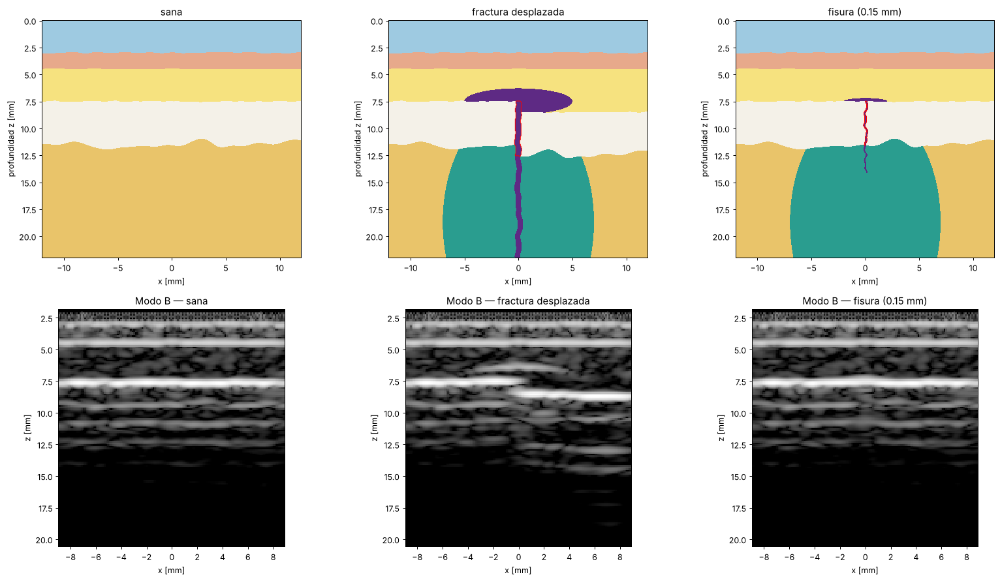
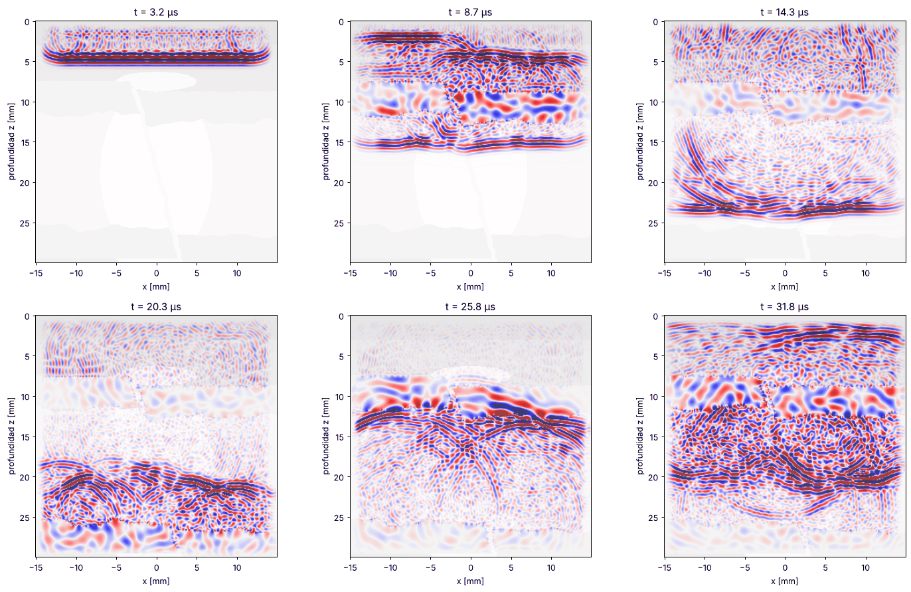
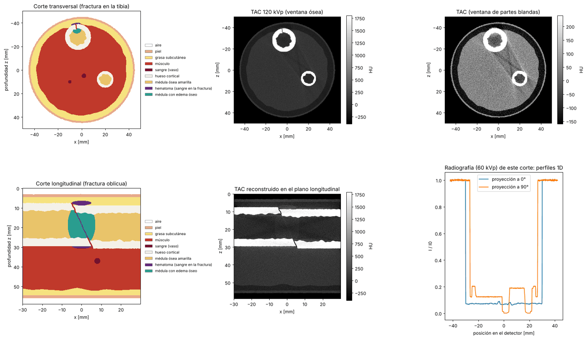
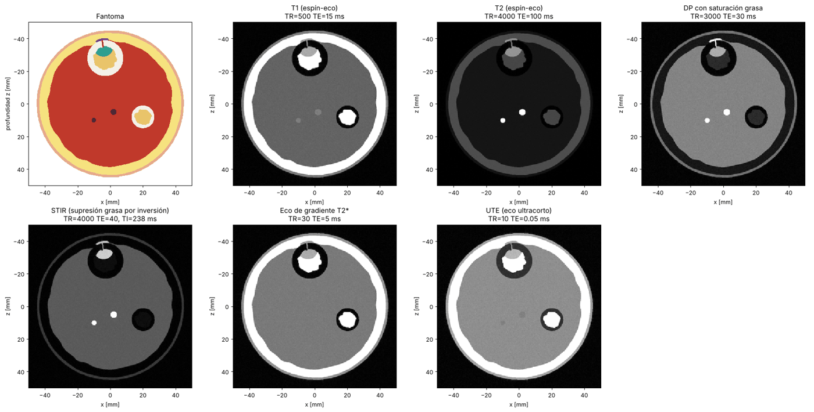
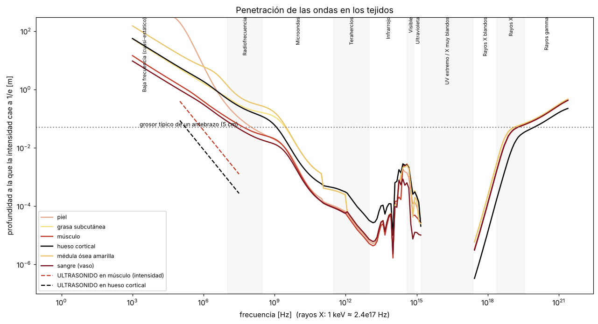

# Wave-simulator

Simulador de ondas a través de tejidos humanos. Sirve para estudiar si el
ultrasonido, las microondas, la luz, los rayos X o la resonancia magnética
permiten ver el interior de una extremidad (en concreto, **fracturas óseas**)
y con qué facilidad. También sirve para generar imágenes sintéticas
etiquetadas con las que entrenar una red neuronal detectora de fracturas.

Todo es 2D (un corte de la extremidad), en Python + NumPy, y corre en CPU.

## Qué simula y con qué física

Cada tipo de onda necesita una física distinta. Usar la equivocada daría
resultados sin sentido (por ejemplo, resolver los rayos X como onda en una
malla exigiría unos 10¹⁰ puntos por milímetro).

| Modalidad | Física | Módulo |
|---|---|---|
| **Ultrasonido** (0.5-15 MHz) | Elastodinámica completa: ondas P y S, conversión de modo en el hueso, reflexión y refracción según la impedancia, atenuación viscoelástica ∝ f (GSLS), speckle por microestructura, rugosidad de las superficies. FDTD de 4.º orden con bordes CPML. | `wavesim.ultrasound` |
| **Radio y microondas** (10 MHz-300 GHz) | Ecuaciones de Maxwell (FDTD, modo TM) con la permitividad y conductividad reales de cada tejido (modelo Cole-Cole de Gabriel 1996). Da el campo, la penetración y el SAR. | `wavesim.em.fdtd_tm` |
| **Baja frecuencia** (< 10 MHz) | Régimen cuasi-estático: div(σ* ∇φ) = 0 con la admitividad compleja de Gabriel, flujo nulo hacia el aire y electrodos en la piel. Da potencial, densidad de corriente, tensiones de borde y una reconstrucción de diferencias de un paso (tomografía de impedancia eléctrica, EIT). | `wavesim.em.quasistatic` |
| **Terahercios, IR, visible, UV** | Transporte de luz: difusión (cuando domina el *scattering*) o atenuación balística (cuando domina la absorción del agua). | `wavesim.em.optics` |
| **Rayos X y gamma** (10 keV-10 MeV) | Beer-Lambert con coeficientes NIST/ICRU-44, espectro de tubo, endurecimiento del haz, ruido de Poisson. Radiografía y TAC (FBP). | `wavesim.em.xray` |
| **Resonancia magnética** | No es una onda que atraviesa el cuerpo, sino la señal de los protones (T1, T2, PD). Ecuaciones de señal validadas con un simulador de Bloch, adquisición en k-space y ruido. Secuencias T1, T2, DP-FS, STIR, GRE y UTE. | `wavesim.mri` |

### Tejidos

Piel, grasa, músculo, sangre, hueso cortical, hueso trabecular, médula
amarilla, hematoma, médula con edema, agua/gel y aire. Cada uno tiene
propiedades acústicas, elásticas, dieléctricas, de rayos X, ópticas y de
RM (`wavesim/materials/`).

### Fantomas con fractura

`wavesim.phantoms` genera cortes longitudinales (tibia, antebrazo, muslo) y
transversales (pierna con tibia y peroné, antebrazo con radio y cúbito,
muslo). Incluyen:

- interfaces rugosas (piel, periostio, endostio) y heterogeneidad interna;
- fracturas transversales, oblicuas, fisuras, conminutas, incompletas y
  desplazadas (escalón cortical);
- grieta con superficie rugosa, hematoma perióstico y edema de médula;
- máscara de verdad de terreno de la fractura (para segmentación).

La misma semilla produce la misma anatomía a cualquier resolución. Así se
puede comparar una modalidad con otra sobre el mismo "paciente".

## Instalación

```bash
pip install -e ".[dev]"         # numpy, matplotlib (+ pytest para los tests)
pip install -e ".[dev,fast]"    # además Numba: ultrasonido ~1.6-3x más rápido
```

**Backend rápido opcional (Numba).** El solver elástico usa por defecto
`backend="auto"`: kernels Numba fusionados y paralelos si Numba está instalado,
y NumPy si no. Ambos dan el mismo resultado (los tests los comparan).
`backend="numpy"` fuerza la referencia; `backend="numba"` falla con un error
claro si falta Numba. Sólo admite float32. La primera ejecución compila los
kernels (unos segundos, luego quedan en caché) y el número de hilos se
controla con `NUMBA_NUM_THREADS`.

## Uso rápido

```python
from wavesim.phantoms import longitudinal_limb, Fracture
from wavesim.ultrasound import simulate_bmode
from wavesim.em import xray
from wavesim.mri import mri_scan

# Tibia con una fractura desplazada 1 mm
p = longitudinal_limb("tibia", Fracture(displacement=1e-3), width=24e-3, depth=22e-3, dx=0.06e-3)

eco = simulate_bmode(p, f0=3e6, angles=(-8, 0, 8))          # ecografía (1-2 min)
tac = xray.ct_scan(p.replace_tissue("water", "air"))          # TAC (segundos)
rm = mri_scan(p.replace_tissue("water", "air"), "STIR")       # RM (instantáneo)
```

## Ejemplos

Cada script guarda sus figuras en `outputs/`:

| Script | Qué muestra |
|---|---|
| `examples/01_fantomas.py` | Anatomías y todos los tipos de fractura |
| `examples/02_propagacion_ultrasonido.py` | Animación del pulso atravesando la tibia fracturada y mapa de presión máxima (penetración y sombra acústica) |
| `examples/03_ecografia_fractura.py` | Ecografía modo B: sana, fractura desplazada y fisura |
| `examples/04_espectro_penetracion.py` | Penetración en todo el espectro y tabla de pérdidas al cruzar el antebrazo |
| `examples/05_microondas.py` | Campo eléctrico y SAR de 128 MHz a 10 GHz, y cambio por la fractura |
| `examples/06_rayos_x_tac.py` | TAC transversal y longitudinal, y radiografía |
| `examples/07_resonancia.py` | La misma pierna con seis secuencias de RM |
| `examples/08_luz.py` | Luz de 450 a 1450 nm a través del antebrazo |
| `examples/09_generar_dataset.py` | Dataset etiquetado para entrenar una red neuronal |
| `examples/10_impedancia_eit.py` | EIT de una pierna a 50 kHz con 16 electrodos: potencial y densidad de corriente sana vs fracturada, cambio de tensiones de borde y reconstrucción de diferencias |

### Resultado principal: ¿qué atraviesa un antebrazo de ~47 mm?

Salida de `04_espectro_penetracion.py`: pérdida de intensidad al cruzarlo
entero a incidencia normal, rodeado de agua. Para radio y microondas las
reflexiones se calculan de forma coherente (matriz de transferencia: las capas
más finas que λ interfieren); para el ultrasonido, sumadas por interfaz (el
pulso de banda ancha promedia la interferencia).

| Onda | Pérdida | Comentario |
|---|---|---|
| Ultrasonido 1 MHz / 5 MHz | 15 / 42 dB | Atraviesa, pero el hueso refleja y atenúa mucho; por eso la ecografía ve la superficie del hueso y deja sombra debajo |
| RF de RM 64 MHz | 3 dB | Penetra (por eso funciona la RM), pero λ en el tejido ≈ 50 cm: no da resolución por sí sola |
| Microondas 915 MHz / 2.45 GHz | 9 / 21 dB | Penetran unos cm; λ ≈ 1.8 cm en músculo a 2.45 GHz: resolución muy pobre |
| Ondas mm 60 GHz | 650 dB | Se absorben en la piel |
| Terahercios 1 THz | ~1900 dB | El agua los absorbe en ~50 µm |
| Infrarrojo cercano 800 nm | 79 dB (difusa) | Algo de luz atraviesa, pero totalmente difusa: ningún fotón llega sin desviarse |
| Luz verde 530 nm | 460 dB | La hemoglobina la absorbe |
| UV 300 nm | > 3000 dB | No pasa de la epidermis |
| Rayos X 60 keV | 5 dB | Atraviesa con contraste hueso/tejido blando: es la herramienta estándar para fracturas |
| Gamma 662 keV | 2 dB | Atraviesa casi sin contraste |

### Ecografía de la fractura



Sonda lineal de 3 MHz (λ ≈ 0.5 mm) sobre la tibia. La fractura desplazada
(escalón de 1 mm) se ve con claridad: cambio medio de 10 dB en la zona. La
fisura de 0.15 mm apenas se distingue (4.6 dB) porque es más fina que λ/3,
igual que en la clínica. El edema de la médula no se ve: queda en la sombra
acústica del hueso.



Propagación del pulso (fotogramas de `02_propagacion.gif`): reflexión en la
superficie del hueso, división del frente en el escalón de la fractura,
transmisión más rápida por la cortical y dispersión por la microestructura.

### Rayos X, TAC y resonancia





La RM ve la fractura sobre todo por el edema y el hematoma (brillantes en
STIR y DP con saturación grasa). En microondas (`05_microondas.py`), la
fractura con su edema y hematoma cambia el campo una mediana de 1.5 dB a
2.45 GHz, pero con una resolución de centímetros.



### Impedancia eléctrica (baja frecuencia)

A 50 kHz la corriente atraviesa la pierna sin problema, pero su resolución es
de ~1 cm. En `10_impedancia_eit.py` el hematoma de la fractura cambia hasta un
~40 % algunas tensiones de borde (~13 % de la tensión máxima), y la
reconstrucción lo localiza con un error de ~6 mm. Sirve para detectar y
localizar de forma aproximada, no para ver la grieta. Además, en una medida
real el ruido y la impedancia de contacto de los electrodos (aquí no
modelada) dificultan medir cambios pequeños.

## Estructura

```
wavesim/
  core/         malla, bordes absorbentes CPML, señales
  materials/    propiedades por tejido y por física (con sus fuentes)
  phantoms/     generadores de extremidades, rugosidad, fracturas
  ultrasound/   solver elástico, atenuación GSLS, sonda lineal, beamforming
  em/           Maxwell FDTD, óptica, proyección/FBP, rayos X, mapa del espectro
  mri/          secuencias, simulador de Bloch, imagen en k-space
  viz/          figuras y animaciones
  datasets/     generación de datos etiquetados
  analysis.py   métricas de visibilidad de la fractura
examples/       scripts de demostración
tests/          validación física (pytest)
```

## Validación

`pytest` (61 tests, ~35 s) compara cada solver con soluciones analíticas:

- **Ultrasonido**: velocidad de las ondas P y S (< 1 %), coeficiente de
  reflexión en una interfaz (medido 0.539 frente a 0.538 teórico),
  atenuación viscoelástica frente al modelo (< 5 %), absorción de la CPML,
  estabilidad en hueso con fractura, beamforming de un dispersor puntual.
- **Maxwell**: constante de fase y atenuación en músculo y grasa frente a la
  permitividad compleja (< 2 % y < 5 %).
- **Materiales**: el modelo dieléctrico reproduce los valores de referencia
  de Gabriel/IT'IS a 1 GHz (< 1 %); la descomposición de rayos X reproduce
  la tabla NIST del músculo (< 1.5 %).
- **Rayos X**: Beer-Lambert exacto en una placa, FBP exacta en un disco,
  unidades Hounsfield del músculo, la grasa y el hueso a 60 keV.
- **Óptica**: el decaimiento de la difusión coincide con μ_eff analítico.
- **RM**: las ecuaciones de espín-eco e inversión-recuperación coinciden con
  la integración numérica de Bloch (1e-6); STIR anula la grasa.

## Comparación con otros simuladores

[docs/comparativa_simuladores.md](docs/comparativa_simuladores.md) compara
wavesim con los simuladores de referencia de cada modalidad: k-Wave, SimSonic,
Field II, openEMS, Meep, gprMax, MCX, GATE, ASTRA, KomaMRI, JEMRIS, EIDORS y
los fantomas XCAT/Virtual Population. Explica qué hace mejor cada uno, cuándo
usar otro en lugar de wavesim y cómo validarlo contra ellos. Incluye una primera
comparación numérica con k-Wave en dos capas fluidas: los coeficientes de
reflexión y transmisión coinciden entre ambos códigos a ±0.3 %. El script es
`benchmarks/kwave_comparison.py` y requiere `pip install k-wave-python scipy`,
que no son dependencias del proyecto.

## Precisión de los datos y limitaciones

- **Fuentes**: las tablas se transcribieron de la literatura (no había
  acceso a las bases de datos online desde el entorno de desarrollo). Las
  dieléctricas y de rayos X están contrastadas con valores de referencia
  (ver tests). Las **ópticas** (sobre todo infrarrojo medio y UV) son de
  orden de magnitud. Las de **RM** del edema, el hematoma y la piel son
  representativas. Cada módulo de `materials/` indica su fuente y su
  incertidumbre.
- La atenuación del ultrasonido con un mecanismo de relajación (por defecto)
  reproduce la ley ∝ f con un error de hasta ~14 % en la banda del pulso. Con
  `n_mechanisms=2` el error baja a ~1 % en músculo (algo más lento); 3
  mecanismos no mejoran con el reparto actual de tiempos de relajación.
- 2D: la dispersión y la difracción de un objeto 3D no son idénticas a las de
  un corte. La "radiografía" de un corte 2D es un perfil 1D; la imagen de
  rayos X útil en 2D es el TAC.
- Rayos X sin radiación dispersa (scatter) ni líneas características del W.
- Microondas en banda estrecha (propiedades a la frecuencia central).
- Hueso isótropo (el real es anisótropo y poroso). Acústica lineal.
- Rendimiento: una ecografía de 3 MHz y 24×22 mm con 3 ángulos tarda ~1 min
  en una CPU con NumPy (Numba lo acelera ~1.6x con 1 hilo y ~3x con 4). A
  7-10 MHz la malla crece mucho (varios minutos o más).

## Próximos pasos posibles

- 3D (necesita GPU: CuPy, JAX o Numba-CUDA).
- Monte Carlo de fotones para la óptica, scatter en rayos X.
- Hueso anisótropo y poroso, callo de consolidación, otras anatomías.
- Entrenamiento de la red neuronal (PyTorch) sobre los datasets generados.
