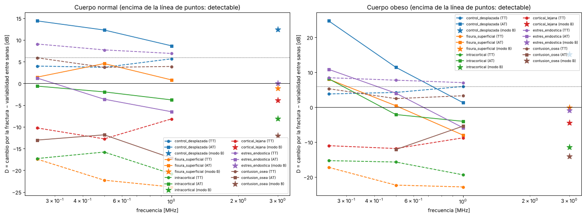
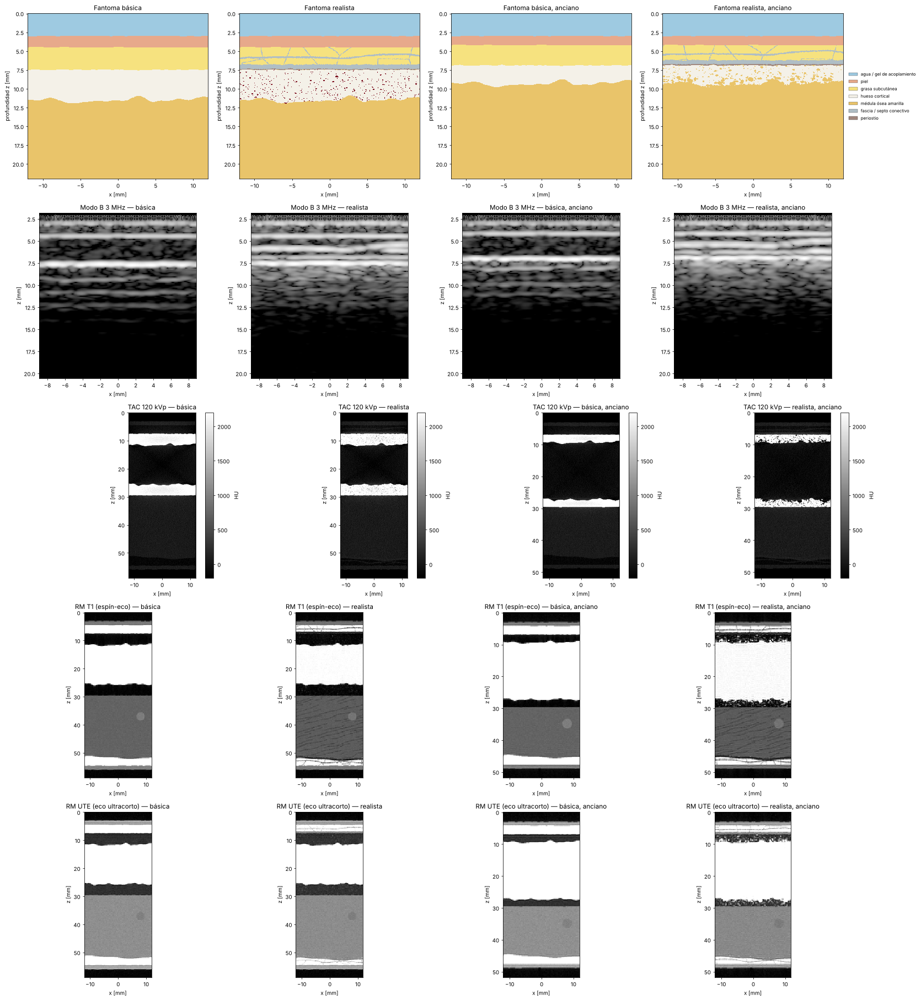

# Wave-simulator

Simulador de ondas a través de tejidos humanos. Sirve para estudiar si el
ultrasonido, las microondas, la luz, los rayos X o la resonancia magnética
permiten ver el interior de una extremidad (en concreto, **fracturas óseas**)
y con qué facilidad. También sirve para generar imágenes sintéticas
etiquetadas con las que entrenar una red neuronal detectora de fracturas.

Casi todo es 2D (un corte de la extremidad), en Python + NumPy, y corre en CPU
(Numba opcional). Hay además un solver elástico 3D para dominios pequeños.

## Qué simula y con qué física

Cada tipo de onda necesita una física distinta. Usar la equivocada daría
resultados sin sentido (por ejemplo, resolver los rayos X como onda en una
malla exigiría unos 10¹⁰ puntos por milímetro).

| Modalidad | Física | Módulo |
|---|---|---|
| **Ultrasonido** (0.5-15 MHz) | Elastodinámica completa: ondas P y S, conversión de modo en el hueso, reflexión y refracción según la impedancia, speckle por microestructura, rugosidad de las superficies. FDTD de 4.º orden. Atenuación viscoelástica GSLS con un peso por mecanismo (2 mecanismos por defecto: error < 2 % frente a la ley α₀·f^y en la banda del pulso). Corrección de la interfaz fluido-sólido a incidencia oblicua. Bordes CPML, con M-PML automática si una capa sólida (cortical) los cruza. Cortical transversalmente isótropa opcional (`anisotropic_bone=True`, desactivada por defecto). | `wavesim.ultrasound` |
| **Imagen de ultrasonido** | Sonda con respuesta de elemento y apodización; onda plana, emisión focalizada y STA; formadores de haz DAS, factor de coherencia, DMAS y SLSC; corrección de velocidad por dos capas; métricas de PSF, speckle, CNR y gCNR. | `wavesim.ultrasound` (`transducer`, `scan`, `beamforming`, `quality`) |
| **Ultrasonido 3D** | Mismo esquema (velocidad-tensión, 4.º orden, CPML, GSLS, cortical anisótropa opcional, corrección de interfaz) en malla 3D, con fantoma de tibia tubular. Para dominios de pocos cm a ≲ 1 MHz. | `wavesim.ultrasound.elastic3d`, `wavesim.phantoms.limb3d` |
| **Radio y microondas** (10 MHz-300 GHz) | Maxwell FDTD modo TM con Cole-Cole de Gabriel 1996: banda estrecha (propiedades a f₀) o **banda ancha** con ajuste de Debye multipolo (ADE) en un solo pulso; promedio sub-celda opcional; kernels Numba. Da el campo, la penetración y el SAR. | `wavesim.em.fdtd_tm`, `fdtd_dispersive` |
| **Baja frecuencia** (< 10 MHz) | Régimen cuasi-estático div(σ* ∇φ) = 0 con la admitividad compleja de Gabriel, electrodos ideales o **modelo completo de electrodo (CEM)**, reconstrucción de diferencias de un paso o **Gauss-Newton** (Tikhonov, Laplaciano, NOSER, TV), precondicionador multigrid (EIT). | `wavesim.em.quasistatic`, `eit`, `multigrid` |
| **Terahercios, IR, visible, UV** | Transporte de luz: difusión, atenuación balística y **Monte Carlo de fotones** (estilo MCML/MCX, Fresnel, resolución temporal opcional, Numba). | `wavesim.em.optics`, `montecarlo` |
| **Rayos X y gamma** (10 keV-10 MeV) | Beer-Lambert con NIST/ICRU-44, espectro de tubo con líneas K, efecto ánodo y filtros de Al/Cu; haz paralelo o en abanico (FBP y OS-SART con TV); radiación dispersa por Monte Carlo (Compton con S(x,Z), Rayleigh); detector con MTF y ruido; endurecimiento del haz, ruido de Poisson. | `wavesim.em.xray`, `fanbeam`, `xray_scatter`, `xray_detector` |
| **Resonancia magnética** | Dos motores: ecuaciones de señal analíticas (por defecto, instantáneo) o **Bloch espacial** (`engine="bloch"`) con isocromatos: desplazamiento químico de la grasa, campo B0 por susceptibilidad, T2*, bobina de superficie y ruido en k-space. Secuencias T1, T2, DP-FS, STIR, GRE y UTE (UTE sólo analítico). | `wavesim.mri` |

### Tejidos

Piel, grasa, músculo, sangre, hueso cortical, hueso trabecular, médula
amarilla, hematoma, médula con edema, agua/gel y aire. Cada uno tiene
propiedades acústicas, elásticas, dieléctricas, de rayos X, ópticas y de
RM (`wavesim/materials/`).

### Fantomas con fractura

`wavesim.phantoms` genera cortes longitudinales (tibia, antebrazo, muslo) y
transversales (pierna con tibia y peroné, antebrazo con radio y cúbito,
muslo). Incluyen:

- interfaces rugosas (piel, periostio, endostio) y heterogeneidad interna;
- fracturas transversales, oblicuas, fisuras, conminutas, incompletas y
  desplazadas (escalón cortical);
- fracturas **internas** que no abren la cortical que mira a la sonda:
  intracorticales, de la cortical lejana, contusión ósea trabecular
  (microfracturas y edema, preset `tibia_metafisis`) y fracturas por estrés
  con reacción perióstica o endóstica;
- grieta con superficie rugosa, hematoma perióstico y edema de médula;
- **tipos de cuerpo** (`BODY_TYPES`: delgado, normal, sobrepeso, obeso,
  musculoso, anciano osteoporótico) que escalan piel, grasa, músculo y hueso
  según rangos publicados; los datasets los sortean;
- máscara de verdad de terreno de la fractura (para segmentación);
- un **modo realista** opcional (`realism="realista"`, ver más abajo): hueso
  poroso, red trabecular, rugosidad fractal, fascias y periostio.

La misma semilla produce la misma anatomía a cualquier resolución. Así se
puede comparar una modalidad con otra sobre el mismo "paciente".

## Instalación

```bash
pip install -e ".[dev]"         # numpy, matplotlib (+ pytest para los tests)
pip install -e ".[dev,fast]"    # además Numba: ultrasonido ~1.6-3x más rápido
```

**Backend rápido opcional (Numba).** El solver elástico usa por defecto
`backend="auto"`: kernels Numba fusionados y paralelos si Numba está instalado,
y NumPy si no. Ambos dan el mismo resultado (los tests los comparan).
`backend="numpy"` fuerza la referencia; `backend="numba"` falla con un error
claro si falta Numba. Sólo admite float32. La primera ejecución compila los
kernels (unos segundos, luego quedan en caché) y el número de hilos se
controla con `NUMBA_NUM_THREADS`.

## Uso rápido

```python
from wavesim.phantoms import longitudinal_limb, Fracture
from wavesim.ultrasound import simulate_bmode
from wavesim.em import xray
from wavesim.mri import mri_scan

# Tibia con una fractura desplazada 1 mm
p = longitudinal_limb("tibia", Fracture(displacement=1e-3), width=24e-3, depth=22e-3, dx=0.06e-3)

eco = simulate_bmode(p, f0=3e6, angles=(-8, 0, 8))          # ecografía (1-2 min)
tac = xray.ct_scan(p.replace_tissue("water", "air"))          # TAC (segundos)
rm = mri_scan(p.replace_tissue("water", "air"), "STIR")       # RM (instantáneo)
```

## Ejemplos

Cada script guarda sus figuras en `outputs/`:

| Script | Qué muestra |
|---|---|
| `examples/01_fantomas.py` | Anatomías y todos los tipos de fractura |
| `examples/02_propagacion_ultrasonido.py` | Animación del pulso atravesando la tibia fracturada y mapa de presión máxima (penetración y sombra acústica) |
| `examples/03_ecografia_fractura.py` | Ecografía modo B: sana, fractura desplazada y fisura |
| `examples/04_espectro_penetracion.py` | Penetración en todo el espectro y tabla de pérdidas al cruzar el antebrazo |
| `examples/05_microondas.py` | Campo eléctrico y SAR de 128 MHz a 10 GHz, y cambio por la fractura |
| `examples/06_rayos_x_tac.py` | TAC transversal y longitudinal, y radiografía |
| `examples/07_resonancia.py` | La misma pierna con seis secuencias de RM |
| `examples/08_luz.py` | Luz de 450 a 1450 nm a través del antebrazo |
| `examples/09_generar_dataset.py` | Dataset etiquetado para entrenar una red neuronal |
| `examples/10_impedancia_eit.py` | EIT de una pierna a 50 kHz con 16 electrodos: potencial y densidad de corriente sana vs fracturada, cambio de tensiones de borde y reconstrucción de diferencias |
| `examples/12_realismo.py` | Fantoma básico frente a realista (hueso poroso, trabéculas, fascias) en ecografía, TAC y RM, en adulto sano y anciano osteoporótico |
| `examples/13_luz_montecarlo.py` | Luz en el antebrazo a 800 nm: Monte Carlo de fotones frente a difusión (la difusión falla cerca de la piel iluminada y en las fronteras) |
| `examples/14_rm_artefactos.py` | RM de la pierna con el simulador de Bloch espacial: desplazamiento químico de la grasa y campo B0 de la susceptibilidad, sin y con artefactos |
| `examples/11_fracturas_internas_baja_frecuencia.py` | ¿Ve el ultrasonido de baja frecuencia (0.25-1 MHz) las fracturas internas que la ecografía no ve? Transmisión a través de la pierna y axial por la cortical, en cuerpo normal y obeso (`--procesos N` para paralelizar; ~30 min) |

### Resultado principal: ¿qué atraviesa un antebrazo de ~47 mm?

Salida de `04_espectro_penetracion.py`: pérdida de intensidad al cruzarlo
entero a incidencia normal, rodeado de agua. Para radio y microondas las
reflexiones se calculan de forma coherente (matriz de transferencia: las capas
más finas que λ interfieren); para el ultrasonido, sumadas por interfaz (el
pulso de banda ancha promedia la interferencia).

| Onda | Pérdida | Comentario |
|---|---|---|
| Ultrasonido 1 MHz / 5 MHz | 15 / 42 dB | Atraviesa, pero el hueso refleja y atenúa mucho; por eso la ecografía ve la superficie del hueso y deja sombra debajo |
| RF de RM 64 MHz | 3 dB | Penetra (por eso funciona la RM), pero λ en el tejido ≈ 50 cm: no da resolución por sí sola |
| Microondas 915 MHz / 2.45 GHz | 9 / 21 dB | Penetran unos cm; λ ≈ 1.8 cm en músculo a 2.45 GHz: resolución muy pobre |
| Ondas mm 60 GHz | 650 dB | Se absorben en la piel |
| Terahercios 1 THz | ~1900 dB | El agua los absorbe en ~50 µm |
| Infrarrojo cercano 800 nm | 79 dB (difusa) | Algo de luz atraviesa, pero totalmente difusa: ningún fotón llega sin desviarse |
| Luz verde 530 nm | 460 dB | La hemoglobina la absorbe |
| UV 300 nm | > 3000 dB | No pasa de la epidermis |
| Rayos X 60 keV | 5 dB | Atraviesa con contraste hueso/tejido blando: es la herramienta estándar para fracturas |
| Gamma 662 keV | 2 dB | Atraviesa casi sin contraste |

### Ecografía de la fractura


Sonda lineal de 3 MHz (λ ≈ 0.5 mm) sobre la tibia. La fractura desplazada
(escalón de 1 mm) se ve con claridad: cambio medio de 10 dB en la zona (10.1 dB). La
fisura de 0.15 mm apenas se distingue (4.7 dB) porque es más fina que λ/3,
igual que en la clínica. El edema de la médula no se ve: queda en la sombra
acústica del hueso.


Propagación del pulso (fotogramas de `02_propagacion.gif`): reflexión en la
superficie del hueso, división del frente en el escalón de la fractura,
transmisión más rápida por la cortical y dispersión por la microestructura.

### Rayos X, TAC y resonancia


La RM ve la fractura sobre todo por el edema y el hematoma (brillantes en
STIR y DP con saturación grasa). En microondas (`05_microondas.py`), la
fractura con su edema y hematoma cambia el campo una mediana de 1.5 dB a
2.45 GHz, pero con una resolución de centímetros.


### Fracturas internas: ¿las ven las frecuencias bajas?



`11_fracturas_internas_baja_frecuencia.py` compara la ecografía (3 MHz) con
dos técnicas de ultrasonido de baja frecuencia (0.25, 0.5 y 1 MHz): la
transmisión a través de la pierna (TT) y la transmisión axial a lo largo de la
cortical (AT, la de la ultrasonometría ósea). Para no confundir la fractura
con diferencias anatómicas, el índice D resta al cambio que produce la
fractura la diferencia entre dos piernas sanas (D ≥ 6 dB = detectable).

| Lesión | Ecografía 3 MHz | Baja frecuencia |
|---|---|---|
| Fractura desplazada 1 mm (control) | sí (D ≈ +13 dB) | sí en AT (+9 a +14 dB) |
| Grieta intracortical o de la cortical lejana | no | no (D entre −1 y −21 dB) |
| Fractura por estrés con reacción endóstica | no | **sí en TT** (+7 a +9 dB): la señal llega ~0.45 µs antes |
| Contusión ósea (edema trabecular) | no | dudoso en TT (+4 a +6 dB) |

Cifras del cuerpo normal. En el cuerpo obeso, la AT a 0.25 MHz da D ≈ +8 dB para la
fisura superficial y la grieta intracortical, pero sólo a esa frecuencia (a 0.5 y
1 MHz, entre +0.4 y −8 dB) y con una sola pareja de piernas sanas de referencia:
no basta para darlo por detección.

Conclusión: ninguna técnica distingue la **grieta** interna en sí, porque
mide 0.1-0.3 mm, mucho menos que la longitud de onda (6 mm a 0.25 MHz), y
dispersa casi nada. Lo que la baja frecuencia sí ve es la **reacción del
hueso**: el engrosamiento endóstico de una fractura por estrés cambia el
tiempo de vuelo a través de todo el hueso. En la práctica las diferencias de
grosor entre personas también cambian ese tiempo, así que haría falta
comparar con la pierna contralateral o barrer a lo largo del hueso. En un
cuerpo obeso la onda guiada por la cortical (AT) deja de separarse de la
onda directa a baja frecuencia. Límites: corte 2D (la tibia real es un tubo),
hueso isótropo y sin porosidad, simulación sin ruido.

### ¿Cuántos emisores y receptores necesita un aparato portátil?

[docs/estudio_emisores_receptores.md](docs/estudio_emisores_receptores.md)
(`benchmarks/estudio_emisores_receptores.py`, 281 simulaciones con ruido
electrónico y piernas sanas distintas como negativos) compara desde un solo
transductor hasta una sonda de 32 × 32. En imagen a 3 MHz la detección de una
fractura desplazada crece con emisores × receptores (AUC 0.38 con 1 × 1, 0.93
con 8 × 8), y emitir con todos los elementos a la vez es lo que más rinde por
canal. En transmisión axial a 0.5-1 MHz basta 1 emisor + 1 receptor con buena
electrónica (AUC 0.84-0.94); más receptores sólo dan robustez al ruido, y en
el cuerpo obeso la técnica falla. Muestra pequeña (6 sanas frente a 2-3 de
cada lesión): son tendencias, no cifras de sensibilidad.

### Modo realista: hueso poroso, trabéculas y fascias



`longitudinal_limb(..., realism="realista")` y `cross_section_limb(..., realism="realista")`
añaden al fantoma de capas:

- **porosidad cortical**: canales de Havers del 5 % en el adulto sano y ~18 %,
  con cavidades y trabecularización endocortical, en `anciano_osteoporotico`;
- una **red trabecular** explícita (BV/TV, grosor, orientación y perforación);
- **rugosidad fina autoafín** (espectro en ley de potencia) en periostio,
  endostio y fracturas;
- **fascias, septos de la grasa, perimisio y periostio**.

Lo que la malla resuelve se dibuja explícito; lo demás queda como fracción de
poro por celda, con la misma densidad media. Cada física usa su regla de
mezcla: lineal (densidad, rayos X, óptica y RM), Maxwell Garnett (dieléctrica)
y Hashin-Shtrikman (elasticidad). Por defecto (`realism=None`) el fantoma es el
de siempre; los datasets usan el modo realista.

En `12_realismo.py`:
- **ecografía**: las fascias dan ecos en la grasa (+17.6 dB) y la cortical porosa
  cambia las reverberaciones limpias por un moteado difuso;
- **TAC**: en el anciano la cortical baja ~300 HU y su desviación pasa de 147 a
  694 HU;
- **RM**: la cortical porosa del anciano se aclara en T1 (de 0.18 a 0.63 respecto
  al músculo).

Las propiedades de fascia y periostio son estimaciones. Por defecto el hueso es
isótropo; la cortical transversalmente isótropa (tensor de Rho 1996, ver
`docs/validacion/anisotropia.md`) se activa con `anisotropic_bone=True`.

### Impedancia eléctrica (baja frecuencia)

A 50 kHz la corriente atraviesa la pierna sin problema, pero su resolución es
de ~1 cm. En `10_impedancia_eit.py` el hematoma de la fractura cambia hasta un
~40 % algunas tensiones de borde (~13 % de la tensión máxima), y la
reconstrucción de un paso lo localiza con un error de ~6 mm (7.2 mm en la
validación; Gauss-Newton con Laplaciano baja a 2-4 mm, con una sola realización
de ruido). Sirve para detectar y localizar de forma aproximada, no para ver la
grieta. El modelo completo de electrodo (`contact_impedance`) incluye la
impedancia de contacto, pero con la piel del fantoma el contacto apenas cambia
la imagen; su valor típico no está verificado. Ver `docs/validacion/eit.md`.

## Estructura

```
wavesim/
  core/         mallas 2D/3D, bordes absorbentes CPML/M-PML, señales
  materials/    propiedades por tejido y por física (con sus fuentes)
  phantoms/     generadores de extremidades, rugosidad, fracturas, tibia 3D
  ultrasound/   solvers elásticos 2D/3D, atenuación GSLS, sonda, STA, formadores
                de haz, métricas de calidad de imagen
  em/           Maxwell FDTD (banda estrecha y ancha), EIT (CEM, Gauss-Newton,
                multigrid), óptica (difusión y Monte Carlo), rayos X (espectro,
                abanico, SART, scatter, detector), mapa del espectro
  mri/          secuencias analíticas, Bloch espacial, susceptibilidad
  viz/          figuras y animaciones
  datasets/     generación de datos etiquetados
  analysis.py   métricas de visibilidad de la fractura
examples/       scripts de demostración
benchmarks/     validación cuantitativa y de rendimiento (generan docs/validacion/)
tests/          validación física (pytest)
docs/           comparativa con otros simuladores y resultados de validación
```

## Validación

`pytest` (467 tests, unos 4 min con 4 hilos de Numba) compara cada solver con
soluciones analíticas y comprueba los fantomas y los datasets. Los benchmarks
de `benchmarks/` repiten las comparaciones con más resolución y escriben sus
tablas en [`docs/validacion/`](docs/validacion/) (un documento por tema, con
las cifras medidas, las referencias que no se pudieron verificar y los
riesgos). Resumen de lo medido:

- **Ultrasonido elástico** ([elastico](docs/validacion/elastico.md)): velocidad
  de fase igual a la del propio esquema (1e-6); convergencia de segundo orden
  en R y T; |R(θ)| agua-cortical ≤ 0.7 % hasta 22° y ángulo crítico a ±0.15°;
  ondas de Lamb S0/A0 a ≤ 2 % de Rayleigh-Lamb (placa libre y en agua). Fuera
  de tolerancia: |R| de 4-5 % en los bordes de 28-53° y 59-70° y de 9-17 % cerca
  de los críticos (limitación del montaje finito, no cambia con la malla).
- **Atenuación** ([atenuacion](docs/validacion/atenuacion.md)): error frente a
  la ley α₀·f^y ≤ 2 % en [0.5, 1.8]·f₀ con 2 mecanismos (y de 1 a 2); con 1
  mecanismo, 14 % a 97 %. Coste de 2 mecanismos: ×1.5.
- **Anisotropía** ([anisotropia](docs/validacion/anisotropia.md)): velocidades
  qP y qSV frente a Christoffel a ≤ 0.1 %.
- **Estabilidad** ([estabilidad](docs/validacion/estabilidad.md)): la cortical
  que cruza la CPML ya no crece en 40 000 pasos (M-PML automática); el precio
  es una reflexión de −28 dB (amplitud) en el hueso.
- **3D** ([elastico3d](docs/validacion/elastico3d.md)): velocidades ≤ 0.4 %,
  equivalencia con el 2D extruido a ~1e-6 y reflexión oblicua a 0.8 %.
- **Imagen de ultrasonido** ([imagen_ultrasonido](docs/validacion/imagen_ultrasonido.md)):
  FWHM lateral dentro de 12 % de la teoría; FWHM axial de un dispersor puntual
  **+9 a +17 %** (no cumple el 10 %); SNR de speckle 1.85 frente a 1.91.
- **Maxwell** ([maxwell](docs/validacion/maxwell.md)): ajuste de Debye ≤ 0.7 %
  frente a Gabriel (0.1-10 GHz); β y α en músculo y grasa a ≤ 0.23 % y ≤ 1.6 %;
  losa multicapa a ≤ 0.11 dB (banda estrecha) y ≤ 0.31 dB (banda ancha,
  dx 0.125 mm); cilindro frente a Mie 2D a 1.7-3.3 % con 15-20 puntos por
  longitud de onda y promedio sub-celda.
- **Óptica** ([optica](docs/validacion/optica.md)): Monte Carlo frente a van de
  Hulst (R y T a ≤ 1.6 σ), Fresnel exacto (1e-7) y atenuación balística (≤ 1.2 σ);
  frente a la difusión, ±1.3 % en μ_eff y 27 % más fluencia en la piel iluminada.
- **Rayos X** ([rayos_x](docs/validacion/rayos_x.md)): abanico igual al haz
  paralelo en FBP; OS-SART gana a FBP un 25-32 % con 30-60 vistas; espectro
  frente a SpekPy a ±5 % de 80 a 120 kVp, pero −6.6 % y −5.2 % de HVL a 50 y
  70 kVp.
- **RM** ([rm](docs/validacion/rm.md)): el Bloch espacial reproduce las
  ecuaciones de señal a 1e-11 o mejor; desplazamiento químico y campo de un
  cilindro (≤ 0.7 % con B0 alineado con la malla) frente a la solución exacta.
- **EIT** ([eit](docs/validacion/eit.md)): CEM frente a la serie de Fourier a
  ≤ 1.5 %; Gauss-Newton localiza una inclusión en un disco a 0.08-0.33 mm
  (Laplaciano, TV, Tikhonov); multigrid de 922 a 13-16 iteraciones
  ([rendimiento_em](docs/validacion/rendimiento_em.md)).
- **Materiales**: el modelo dieléctrico reproduce los valores de referencia
  de Gabriel/IT'IS a 1 GHz (< 1 %); la descomposición de rayos X reproduce
  la tabla NIST del músculo (< 1.5 %).

Casi toda la validación es frente a soluciones analíticas y a referencias
internas. La comparación directa con otro simulador sólo se hizo con k-Wave en
un caso (dos capas fluidas, ±0.3 %) y con SpekPy en espectros de rayos X.

## Comparación con otros simuladores

[docs/comparativa_simuladores.md](docs/comparativa_simuladores.md) compara
wavesim con los simuladores de referencia de cada modalidad: k-Wave, SimSonic,
Field II, openEMS, Meep, gprMax, MCX, GATE, ASTRA, KomaMRI, JEMRIS, EIDORS y
los fantomas XCAT/Virtual Population. Explica qué hace mejor cada uno, cuándo
usar otro en lugar de wavesim y cómo validarlo contra ellos, con una tabla de
brechas cerradas y abiertas.

**Comparación cruzada directa** (cada herramienta ejecutada aquí en CPU, en un
entorno aparte; no son dependencias del proyecto; detalle en
`docs/validacion/cruzada_*.md`):

| Modalidad | Referencia | Acuerdo medido |
|---|---|---|
| Ultrasonido | k-Wave, Devito | R y T ≤ 0.28 %; atenuación ±1.1 %; \|R\| agua-hueso a 45° a 0.1-0.7 % de la analítica |
| Maxwell | gprMax | losa 0.013 dB; pierna: campo 0.04-0.6 %, SAR 0.13-1.2 % |
| Luz | MCML, MCX | totales ≤ 0.15 %; perfiles ≤ 2.5 % |
| Rayos X | ASTRA, SpekPy, XCIST | proyector ≤ 0.4 %; HVL 2.8 % de media; scatter sin acuerdo con XCIST |
| EIT | pyEIT | cambio de tensiones 0.5 %; posición 0-0.9 mm |

Los tests `tests/test_cross_*.py` comparan wavesim con resultados guardados de
esas herramientas, sin necesidad de instalarlas.

## Precisión de los datos y limitaciones

- **Fuentes**: las tablas se transcribieron de la literatura (no había
  acceso a las bases de datos online desde el entorno de desarrollo). Las
  dieléctricas y de rayos X están contrastadas con valores de referencia
  (ver tests). Las **ópticas** (sobre todo infrarrojo medio y UV) son de
  orden de magnitud. Las de **RM** del edema, el hematoma y la piel son
  representativas. Cada módulo de `materials/` indica su fuente y su
  incertidumbre. Varias cifras de los documentos de validación vienen de
  memoria y están marcadas como no verificadas (tablas de Cu y W, g óptico,
  c13 y densidad de la cortical, χ de los tejidos, impedancia de contacto de los
  electrodos).
- **Atenuación**: con 2 mecanismos (por defecto) el error es < 2 % en la banda
  del pulso (±0.5-1.8 f₀); en pulsos de banda muy ancha usar `n_mechanisms=3`.
  Con 1 mecanismo, el valor anterior, llega a ~14 %. Con `y = 2` y pérdidas muy
  altas el error sube a 3.7 % (2 mecanismos).
- **2D**: la dispersión y la difracción de un objeto 3D no son idénticas a las de
  un corte (una fuente puntual es una línea infinita: la amplitud decae como
  d^-1.9 en lugar de d^-3 en la transmisión axial). El solver 3D lo resuelve,
  pero sólo para dominios pequeños (~27 Mceldas·paso/s por hilo), sin speckle,
  porosidad ni rugosidad, y **con la CPML clásica**: una cortical anisótropa que
  entra en la capa sin atenuación es inestable (usar `bone_length`). La
  "radiografía" de un corte 2D es un perfil 1D; la imagen de rayos X útil en 2D
  es el TAC.
- **Ultrasonido**: acústica lineal (sin no linealidad); tejidos blandos como
  fluido; sonda ideal salvo la respuesta de elemento. La FWHM axial de un
  dispersor puntual sale 9-17 % mayor que la teoría y ninguna variante de
  formación de haz mejora de forma clara la visibilidad de la fisura de 0.15 mm
  (sin ruido electrónico ni observador). La corrección de interfaz y la M-PML
  tienen costes: la M-PML refleja −28 dB (amplitud) en el hueso. La inestabilidad
  de la tibia osteoporótica realista (su cortical cruzaba la CPML) está corregida
  por la M-PML ([estabilidad](docs/validacion/estabilidad.md)). La anisotropía de la cortical sólo está alineada con la
  malla y el valor de c13 no está verificado.
- **Maxwell**: 2D TM, sin antenas ni fuentes reales; la fuente de onda plana de
  banda ancha debe estar en una zona homogénea; el error de campo fuera del
  cilindro de hueso se queda en ~0.8 % sin origen identificado.
- **Óptica**: Monte Carlo con índice de refracción único por tejido (1.4) y g
  igual para todos (0.9): sin valores de g verificados por tejido; superficie
  curva en escalera; la transmisión de la pierna a 800 nm es 10⁻⁸ en las
  columnas gruesas, al límite de lo medible.
- **Rayos X**: el scatter es Monte Carlo con objeto infinito en y, sin
  fluorescencia ni Doppler, y no hay corrección de scatter en la reconstrucción;
  sin *short scan* ni haz cónico 3D; la HVL del espectro se aparta de SpekPy
  (−5 a −7 %) a 50-70 kVp; los dos parámetros libres se ajustaron a los mismos
  casos de SpekPy.
- **RM**: 2D (sin perfil de corte, flujo ni movimiento), spoiling ideal, sólo
  trayectorias cartesianas, χ de los tejidos blandos ≈ agua, error de 2.6-5.5 %
  en el campo B0 con B0 oblicuo a la malla. No se ha comparado con KomaMRI ni
  JEMRIS.
- **EIT**: 2D con diferencias finitas (sin FEM ni 3D); GREIT entrenado sin
  implementar; los resultados de Gauss-Newton son de una sola realización de
  ruido (70 dB) y un tamaño de inclusión.
- **Rendimiento**: una ecografía de 3 MHz y 24×22 mm con 3 ángulos tarda ~20 s
  con Numba y 4 hilos (2 mecanismos); con NumPy ~1 min. A 7-10 MHz la malla crece
  mucho (varios minutos o más). Sin GPU.
- **Comparación cruzada parcial**: hecha con k-Wave, Devito, gprMax, MCML, MCX,
  ASTRA, SpekPy, XCIST y pyEIT (ver abajo); falta en RM (KomaMRI, JEMRIS), en el
  solver 3D y frente a SimSonic o Field II. Ha dejado a la vista tres puntos
  débiles: la forma de onda del ultrasonido difiere 6-8 % de k-Wave con la CFL
  0.9 por defecto (0.3-0.9 % con CFL 0.3), la HVL del espectro de rayos X se
  aparta +6-7 % a 140-150 kVp, y el scatter no concuerda con XCIST (que no es una
  referencia física). No hay validación revisada por pares.

## Próximos pasos posibles

- Completar la comparación cruzada: KomaMRI o JEMRIS para la RM, GATE o MC-GPU
  para el scatter, SimSonic o k-Wave elástico para el hueso.
- Reducir la dispersión temporal del ultrasonido (CFL menor por defecto o
  corrección de la dispersión) y recalibrar el espectro de rayos X a kVp altos.
- GPU (CuPy, JAX o Numba-CUDA) para el 3D y los B-mode a frecuencias altas.
- M-PML en el solver 3D y un p dependiente del material en el 2D.
- Corrección de scatter en la reconstrucción, *short scan* y haz cónico.
- Radial/espiral y flujo en RM; GREIT y FEM en EIT; antenas y 3D en Maxwell.
- Callo de consolidación y otras anatomías; entrenamiento de la red neuronal
  (PyTorch) sobre los datasets generados.
