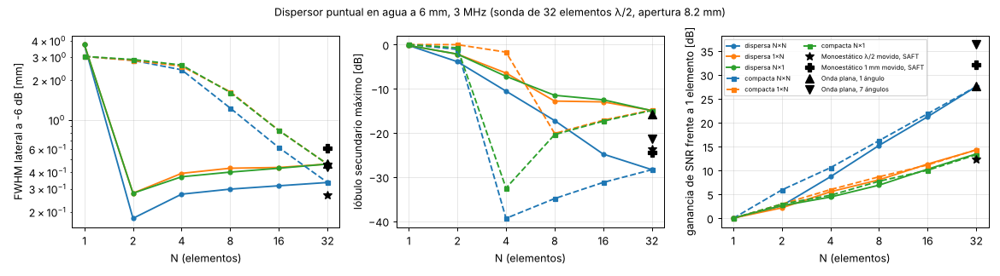
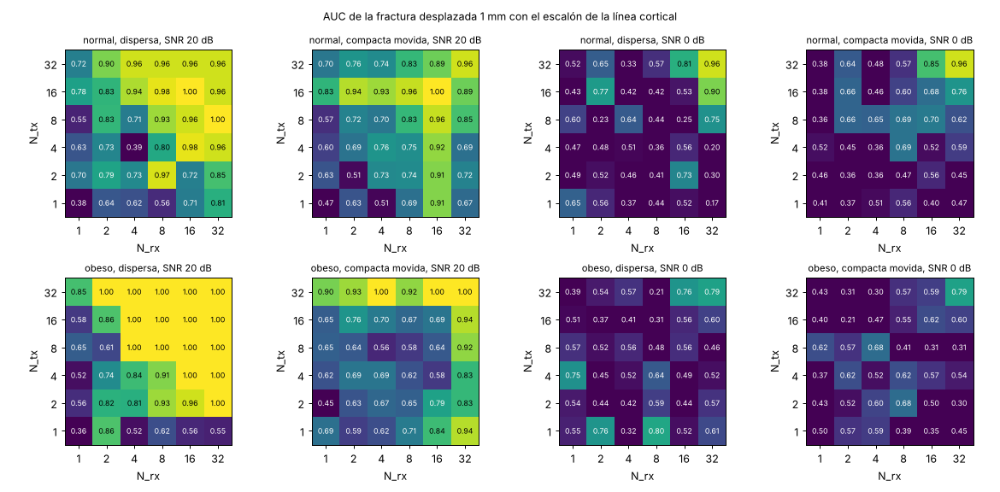
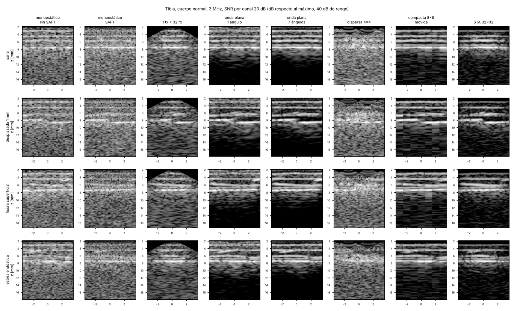
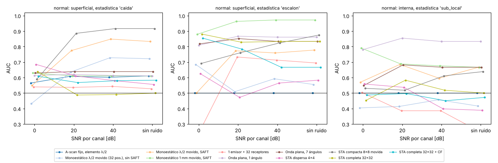
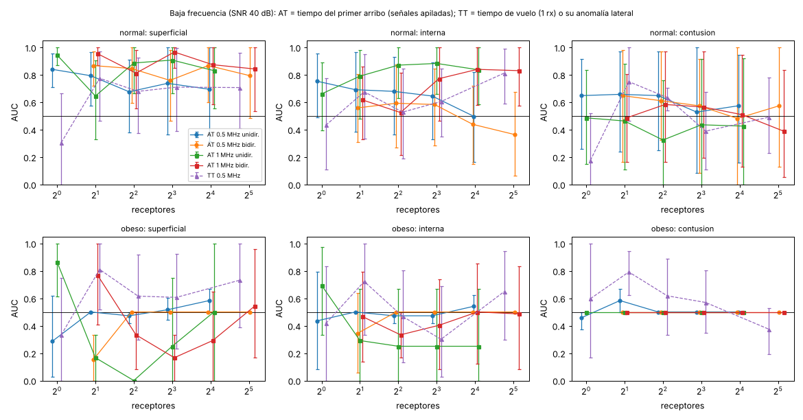

# ¿Cuántos emisores y receptores para detectar fracturas? Estudio con simulación

Pregunta: para un dispositivo portátil y barato de detección rápida de fracturas, ¿mejora la
detección tener uno o varios emisores y uno o varios receptores, cuántos y en qué disposición?

Código: `benchmarks/estudio_emisores_receptores.py` (simulación y análisis, con caché en
`outputs/estudio_er/`), `wavesim/ultrasound/fmc.py` (captura de matriz completa y reconstrucción
de subconjuntos; tests en `tests/test_fmc.py`).

## Respuesta corta

**Sí, pero depende de para qué.** Hay dos aparatos distintos detrás de la pregunta:

1. **Para ver una fractura en una imagen (3 MHz, reflexión), hacen falta varios canales.** Un solo
   transductor quieto (A-scan) no distingue una tibia rota de una sana (AUC 0.50). La detección de una
   fractura desplazada 1 mm sube con el producto emisores × receptores: en el cuerpo normal, de 0.38
   (1×1) a 0.93 (8×8) y 1.00 (16×16) con electrónica de 20 dB de SNR por canal. Lo que da más
   rendimiento por canal no es añadir receptores sino **emitir con todos los elementos a la vez**
   (onda plana): con 1 disparo iguala la ganancia de ruido de 32 disparos de un elemento (+27.6 dB) y es
   la única familia, junto con la sonda completa 32×32, que aguanta electrónica mala (0 dB por canal).
2. **Para un cribado sin imagen (0.5-1 MHz, transmisión axial a lo largo del hueso), basta 1 emisor +
   1 receptor si la electrónica es buena** (AUC 0.84-0.94 en fracturas que abren la cortical, cuerpo
   normal, 40 dB). Más receptores no detectan más: sirven para **aguantar el ruido** (a 20 dB un
   receptor cae a 0.50 y 2 emisores + 8 receptores apilados recuperan 0.92 a 1 MHz). En el cuerpo
   obeso esta técnica falla con cualquier número de receptores.

Las lesiones sutiles no se arreglan con más canales. En imagen a 3 MHz ninguna configuración detecta
de forma fiable la fisura fina, la grieta intracortical, la fractura por estrés ni la contusión. La
transmisión axial sí ve la fisura y la grieta intracortical en el cuerpo normal (0.85-0.94 con 1 emisor
+ 1 receptor a 40 dB); la fractura por estrés y la contusión no las ve ninguna técnica del estudio.

**Aviso sobre la precisión.** Hay 6 piernas sanas frente a 3 (normal) o 2 (obeso) de cada lesión: los
intervalos son de ±0.2-0.3 y un «1.00 [1.00-1.00]» significa «separó las 3 de las 6», no «sensibilidad
100 %». Valen las tendencias que se repiten en los dos cuerpos y que la física explica (resolución,
lóbulos, ganancia de ruido), no las diferencias entre dos casillas vecinas.

## Resultados

Tablas completas: [estudio_emisores_receptores_tablas.md](estudio_emisores_receptores_tablas.md).

### 1. Calidad de imagen: qué compra cada canal

Dispersor puntual en agua a 6 mm, 3 MHz (λ = 0.5 mm). Ganancia de SNR respecto a un elemento que
emite y recibe.

| Configuración | Disparos | Canales rx | FWHM lateral (mm) | Lóbulo máx. (dB) | Ganancia SNR (dB) |
|---|---|---|---|---|---|
| 1 emisor-receptor quieto (1×1) | 1 | 1 | 3.74 (sin resolución) | 0 | 0.0 |
| Monoestático λ/2 movido, líneas A apiladas | 32 | 1 | 3.04 | 0 | −0.4 |
| Monoestático λ/2 movido, SAFT | 32 | 1 | 0.27 | −24 | 12.3 |
| Ídem con error de posición σ = 0.1 mm | 32 | 1 | 0.31 | −19 | 10.2 |
| Monoestático de 1 mm movido, SAFT | 29 | 1 | 0.61 | −25 | 32.0 |
| 1 emisor + 8 receptores (dispersa) | 1 | 8 | 0.43 | −13 | 8.0 |
| 8 emisores + 1 receptor (dispersa) | 8 | 1 | 0.40 | −11 | 6.9 |
| 1 emisor + 32 receptores | 1 | 32 | 0.46 | −15 | 14.3 |
| Onda plana, 1 ángulo (32 emiten a la vez) | 1 | 32 | 0.47 | −16 | 27.6 |
| Onda plana, 7 ángulos | 7 | 32 | 0.44 | −21 | 36.3 |
| Dispersa 2×2 | 2 | 2 | 0.18 | −4 | 2.6 |
| Dispersa 4×4 | 4 | 4 | 0.27 | −11 | 8.7 |
| Dispersa 8×8 | 8 | 8 | 0.30 | −17 | 15.2 |
| Dispersa 16×16 | 16 | 16 | 0.32 | −25 | 21.2 |
| Compacta 4×4 movida | 4 por posición | 4 | 2.41 | −39 | 10.5 |
| Compacta 8×8 movida | 8 por posición | 8 | 1.23 | −35 | 16.2 |
| Compacta 16×16 movida | 16 por posición | 16 | 0.62 | −31 | 21.8 |
| STA completa 32×32 | 32 | 32 | 0.33 | −28 | 27.5 |

Lectura:

- **La resolución la da la apertura, no el número de elementos.** Dos elementos en los extremos de
  8.2 mm ya dan 0.18 mm, pero con lóbulos de −4 dB: la imagen es una rejilla de fantasmas. Los elementos
  intermedios no afinan el punto; bajan los lóbulos (−11 dB con 4×4, −17 con 8×8, −25 con 16×16).
- **La sonda compacta (pocos elementos juntos) hace lo contrario:** lóbulos limpios (−31 a −39 dB) y
  mala resolución (2.4 mm con 4, 1.2 mm con 8), porque su apertura es pequeña.
- **Emisores y receptores son intercambiables para la imagen** (1×8 y 8×1: 0.43 y 0.40 mm, 8.0 y
  6.9 dB), como exige la reciprocidad. La diferencia es de coste: un receptor más es un canal de
  electrónica; un emisor más disparado por separado es un disparo más (tiempo), no un canal.
- **La ganancia de ruido sigue al producto N_tx × N_rx** (8×8: 15.2 dB; 32×32: 27.5 dB) cuando los
  emisores disparan de uno en uno. Disparando los 32 a la vez, un solo disparo da 27.6 dB.
- **Un transductor grande gana ruido gratis:** el de 1 mm (cuatro elementos λ/2 soldados) da 32 dB con
  un solo canal, a costa de resolución (0.61 mm) y de tener que moverlo conociendo su posición.

### 2. Detección de la fractura desplazada frente a N_tx × N_rx

Estadística: escalón de la línea cortical. Disposición dispersa (misma apertura de 8.2 mm).

Cuerpo normal, SNR 20 dB por canal (3 fracturas frente a 6 sanas; filas N_tx, columnas N_rx):

| N_tx \ N_rx | 1 | 2 | 4 | 8 | 16 | 32 |
|---|---|---|---|---|---|---|
| 1 | 0.38 | 0.64 | 0.62 | 0.56 | 0.71 | 0.81 |
| 2 | 0.70 | 0.79 | 0.73 | 0.97 | 0.72 | 0.85 |
| 4 | 0.63 | 0.73 | 0.39 | 0.80 | 0.98 | 0.96 |
| 8 | 0.55 | 0.83 | 0.71 | 0.93 | 0.96 | 1.00 |
| 16 | 0.78 | 0.83 | 0.94 | 0.98 | 1.00 | 0.96 |
| 32 | 0.72 | 0.90 | 0.96 | 0.96 | 0.96 | 0.96 |

- El AUC crece hacia la esquina de muchos emisores y muchos receptores, de forma aproximadamente
  simétrica; con al menos 4 emisores, 4 receptores y producto N_tx·N_rx ≥ 64 está en 0.93-1.00, y con
  producto menor de 16, en 0.38-0.79. El cuerpo
  obeso repite el patrón (8×8: 1.00; 1×1: 0.36).
- El ruido de la tabla es el de la muestra: la casilla 4×4 (0.39) entre vecinas de 0.7-0.8 no es un
  efecto real demostrable.
- **A 0 dB por canal sólo sobrevive la esquina:** 32×32 da 0.96 (normal) y 0.79 (obeso); 16×32, 0.90;
  todo lo demás queda entre 0.17 y 0.81 sin orden.

### 3. Configuraciones de aparato

AUC de la fractura desplazada (escalón) a 40 / 20 / 0 dB de SNR por canal. Entre corchetes, el IC 95 %
a 20 dB.

| Configuración | Disparos | Canales rx | Normal 40 / 20 / 0 dB | Obeso 40 / 20 / 0 dB |
|---|---|---|---|---|
| A-scan fijo (λ/2 o 1 mm) | 1 | 1 | 0.50 / 0.50 / 0.50 (sin imagen no hay escalón) | 0.50 / 0.50 / 0.50 |
| Monoestático λ/2 movido, sin SAFT | 32 | 1 | 0.67 / 0.68 [0.35-0.96] / 0.70 | 0.56 / 0.62 [0.28-0.93] / 0.38 |
| Monoestático λ/2 movido, SAFT | 32 | 1 | 0.80 / 0.85 [0.54-1.00] / 0.52 | 1.00 / 0.93 [0.78-1.00] / 0.59 |
| Ídem, posición con error σ = 0.1 mm | 32 | 1 | 1.00 / 0.93 [0.78-1.00] / 0.44 | 0.89 / 0.89 [0.67-1.00] / 0.44 |
| Monoestático 1 mm movido, sin SAFT | 29 | 1 | 0.61 / 0.61 [0.17-1.00] / 0.62 | 0.67 / 0.74 [0.39-1.00] / 0.73 |
| Monoestático 1 mm movido, SAFT | 29 | 1 | 1.00 / 1.00 / 1.00 | 1.00 / 1.00 / 1.00 |
| 1 emisor + 32 receptores | 1 | 32 | 0.72 / 0.81 [0.52-1.00] / 0.17 | 0.92 / 0.55 [0.30-0.81] / 0.61 |
| 32 emisores (uno a uno) + 1 receptor | 32 | 1 | 0.67 / 0.72 [0.41-0.97] / 0.52 | 0.79 / 0.85 [0.56-1.00] / 0.39 |
| Onda plana, 1 ángulo | 1 | 32 | 0.94 / 0.94 [0.78-1.00] / 0.89 | 1.00 / 1.00 / 1.00 |
| Onda plana, 3 ángulos | 3 | 32 | 1.00 / 1.00 / 0.86 | 1.00 / 1.00 / 1.00 |
| Onda plana, 7 ángulos | 7 | 32 | 0.89 / 0.93 [0.78-1.00] / 0.89 | 1.00 / 1.00 / 1.00 |
| STA dispersa 4×4 | 4 | 4 | 0.35 / 0.39 [0.02-0.76] / 0.51 | 0.92 / 0.84 [0.65-0.96] / 0.52 |
| STA dispersa 8×8 | 8 | 8 | 0.88 / 0.93 [0.67-1.00] / 0.44 | 1.00 / 1.00 / 0.48 |
| STA compacta 8×8 movida | 8 por pos. | 8 | 0.89 / 0.83 [0.52-1.00] / 0.69 | 0.58 / 0.58 [0.17-1.00] / 0.41 |
| STA compacta 16×16 movida | 16 por pos. | 16 | 1.00 / 1.00 / 0.68 | 0.67 / 0.69 [0.17-1.00] / 0.62 |
| STA completa 32×32 | 32 | 32 | 0.94 / 0.96 [0.85-1.00] / 0.96 | 1.00 / 1.00 / 0.79 |
| STA completa 32×32 + factor de coherencia | 32 | 32 | 0.94 / 0.94 [0.78-1.00] / 0.91 | 0.83 / 0.83 [0.50-1.00] / 0.61 |

- **Sin imagen no se ve.** El A-scan fijo y las líneas A apiladas sin procesar (0.6-0.7) no detectan.
- **Con electrónica buena (≥ 20 dB) llegan a 0.9-1.0 por tres caminos distintos:** la onda plana, la
  dispersa de 8×8 o más, y un solo transductor movido con SAFT.
- **Con electrónica mala (0 dB) sólo quedan los que suman mucha energía:** onda plana (0.86-1.00),
  32×32 (0.79-0.96) y el transductor de 1 mm con SAFT (1.00 en los dos cuerpos). El transductor λ/2 con
  SAFT, 1×32, 8×8 y 4×4 caen al azar.
- **El factor de coherencia no ayuda** (igual o peor en todos los casos): se deja fuera.
- **La sonda compacta movida funciona en el cuerpo normal (0.83-1.00) y no en el obeso (0.58-0.69)**,
  donde el hueso está más hondo y su apertura pequeña resuelve peor. Con 2 positivos no es concluyente.
- **El resultado del transductor de 1 mm con SAFT supone conocer su posición en cada disparo.** El error
  de posición sólo se simuló para el de λ/2 (σ = 0.1 mm: sigue en 0.89-0.93 a 20 dB); con un error de
  milímetros, como el de una mano sin seguimiento, el SAFT no enfoca y este resultado no vale.

### 4. Por qué: cambio que produce la lesión frente al que produce el ruido

Lesión central del cuerpo normal frente a la misma pierna sin lesión. D = cambio de la imagen en la
zona de la lesión menos el que produce el ruido (dB); D > 0 significa que la lesión cambia la imagen
más que el ruido. Columnas: D a 20 dB / D a 0 dB.

| Configuración | Desplazada | Fisura superficial | Intracortical | Estrés endóstica | Contusión |
|---|---|---|---|---|---|
| Monoestático λ/2, sin SAFT | +3.8 / −17.5 | −1.3 / −23.0 | −11.2 / −33.5 | −25.9 / −46.8 | −21.3 / −42.8 |
| Monoestático λ/2, SAFT | +3.1 / −18.2 | +0.1 / −21.7 | −7.7 / −30.0 | −24.5 / −45.4 | −20.5 / −42.2 |
| 1 emisor + 32 receptores | +8.8 / −12.3 | +2.9 / −18.4 | −7.6 / −29.2 | −22.3 / −43.1 | −20.1 / −41.8 |
| STA dispersa 4×4 | +4.7 / −16.5 | +0.7 / −20.7 | −13.8 / −36.0 | −29.4 / −50.2 | −22.6 / −44.0 |
| STA compacta 8×8 movida | +18.7 / −2.4 | +8.4 / −12.1 | −1.2 / −23.3 | −13.5 / −34.3 | −9.8 / −31.6 |
| STA completa 32×32 | +21.1 / +0.1 | +13.9 / −6.6 | +1.5 / −20.5 | −14.6 / −35.4 | −10.2 / −32.0 |
| Onda plana, 1 ángulo | +27.4 / +6.3 | +18.5 / −1.4 | +10.1 / −10.3 | −0.3 / −21.6 | +2.7 / −18.6 |
| Onda plana, 7 ángulos | +35.6 / +14.6 | +26.5 / +6.4 | +16.5 / −3.6 | +3.8 / −17.7 | +5.9 / −15.2 |

- El cambio que produce la lesión es casi el mismo con cualquier configuración (desplazada ≈ 0 dB,
  fisura ≈ −15 dB, internas −10 a −20 dB respecto a la imagen). **Lo que cambia entre configuraciones es
  cuánto ruido hay debajo**, es decir, la energía emitida y el número de señales que se suman.
- La onda plana gana 19 dB a «1 emisor + 32 receptores» con el mismo disparo y los mismos canales: la
  única diferencia es que emiten los 32 elementos en vez de uno.
- Las lesiones internas y la contusión producen un cambio 10-20 dB menor que la imagen: aunque el ruido
  no las tape (onda plana de 7 ángulos a 20 dB), quedan por debajo de la variación entre personas. Por
  eso su AUC es errático y no mejora con los canales.

### 5. Lesiones sutiles a 3 MHz

AUC a 20 dB por canal, cuerpo normal / obeso:

| Configuración | Fisura (escalón) | Internas (exceso local bajo la cortical) | Contusión (energía bajo la cortical) |
|---|---|---|---|
| Monoestático 1 mm, SAFT | 0.93 / 0.33 | 0.69 / 0.45 | 0.53 / 0.64 |
| Onda plana, 1 ángulo | 0.79 / 0.31 | 0.85 / 0.45 | 0.53 / 0.50 |
| Onda plana, 7 ángulos | 0.78 / 0.50 | 0.68 / 0.98 | 0.48 / 0.75 |
| STA dispersa 8×8 | 0.78 / 0.87 | 0.69 / 0.42 | 0.31 / 0.54 |
| STA completa 32×32 | 0.69 / 0.39 | 0.58 / 0.92 | 0.46 / 0.81 |

Ninguna fila es buena en los dos cuerpos. Con 2-3 positivos por casilla, valores sueltos de 0.9 no
demuestran nada. Es coherente con el ejemplo 11: a 3 MHz en reflexión estas lesiones no se ven.

### 6. Baja frecuencia sin imagen

**Transmisión axial (AT)**, estadística *tiempo* (retraso del primer arribo por el hueso). AUC de las
fracturas superficiales (desplazada + fisura; 6 frente a 6 en el cuerpo normal):

| Configuración | Emisores | Receptores | 0.5 MHz, 40 dB | 0.5 MHz, 20 dB | 1 MHz, 40 dB | 1 MHz, 20 dB |
|---|---|---|---|---|---|---|
| Unidireccional | 1 | 1 | 0.84 [0.71-0.96] | 0.50 | 0.94 [0.87-1.00] | 0.52 |
| Unidireccional | 1 | 2 | 0.79 | 0.54 | 0.65 | 0.78 |
| Unidireccional | 1 | 4 | 0.68 | 0.60 | 0.89 | 0.76 |
| Unidireccional | 1 | 8 | 0.74 | 0.75 [0.62-0.88] | 0.91 | 0.85 [0.63-1.00] |
| Unidireccional | 1 | 17 | 0.69 | 0.80 [0.60-0.95] | 0.83 | 0.80 [0.59-0.96] |
| Bidireccional | 2 | 2 | 0.87 [0.72-0.97] | 0.50 | 0.95 [0.87-1.00] | 0.50 |
| Bidireccional | 2 | 4 | 0.85 | 0.41 | 0.81 | 0.90 [0.73-1.00] |
| Bidireccional | 2 | 8 | 0.76 | 0.28 | 0.97 [0.85-1.00] | 0.92 [0.76-1.00] |
| Bidireccional | 2 | 16 | 0.87 | 0.60 | 0.87 | 0.90 [0.68-1.00] |
| Bidireccional | 2 | 34 | 0.79 | 0.62 | 0.84 | 0.89 [0.72-0.99] |

- **Con buena electrónica, un emisor y un receptor bastan** (0.84 a 0.5 MHz, 0.94 a 1 MHz), y añadir
  receptores no mejora: las diferencias entre filas a 40 dB están dentro del intervalo.
- **Con electrónica de 20 dB, un receptor no ve nada (0.50) y varios apilados sí:** a 1 MHz, 0.85 con
  1 emisor + 8 receptores y 0.90-0.92 con 2 emisores + 4-16 receptores. A 0.5 MHz la recuperación es
  menor (0.75-0.80 unidireccional) y la bidireccional no funciona (0.28-0.62).
- **Lo que detecta es el retraso, no la velocidad.** La pendiente tiempo-distancia (la «velocidad del
  hueso» de los equipos de osteoporosis) da 0.55-0.71, y el salto entre receptores 0.2-0.7: una
  fractura situada entre el emisor y los receptores retrasa todas las llegadas por igual y no cambia la
  pendiente.
- Por lesión (1 emisor + 1 receptor, 40 dB, cuerpo normal): desplazada 0.81 / 0.98 (0.5 / 1 MHz),
  fisura 0.87 / 0.91, **grieta intracortical 0.94 / 0.85**, estrés endóstica 0.56 / 0.48, contusión
  0.65 / 0.49. Es la única técnica del estudio que ve la grieta intracortical.
- **En el cuerpo obeso no funciona.** A 0.5 MHz el primer arribo no se mide en 1 de 6 piernas sanas y
  en 4 de 8 con lesión aun sin ruido; casi todas las casillas son 0.50. A 1 MHz, 1 emisor + 1 receptor
  da 0.87 [0.61-1.00] a 40 dB, pero con 2-8 receptores apilados el AUC es 0.00-0.25: en las piernas
  fracturadas el apilado no encuentra el primer arribo y la convención «no medible = sano» lo cuenta
  al revés. La pérdida de señal podría ser en sí un indicio, pero con 4 positivos no se puede afirmar.

**Transmisión a través (TT, 0.5 MHz)**, cuerpo normal / obeso, 40 dB:

| Receptores | Superficial | Interna | Contusión | Cortical lejana |
|---|---|---|---|---|
| 1 (10 mm) | 0.31 / 0.33 | 0.43 / 0.42 | 0.18 / 0.60 | 0.39 / 0.16 |
| 2 (diferencia entre los dos) | 0.77 / 0.81 | 0.68 / 0.72 | 0.75 / 0.79 | 0.67 / 0.78 |
| 4 | 0.68 / 0.62 | 0.53 / 0.47 | 0.63 / 0.62 | 0.55 / 0.47 |
| 8 | 0.71 / 0.61 | 0.60 / 0.30 | 0.39 / 0.57 | 0.53 / 0.41 |
| 25 | 0.71 / 0.73 | 0.81 / 0.65 | 0.49 / 0.38 | 0.75 / 0.73 |

- Un solo receptor no sirve (0.2-0.6): el tiempo de vuelo absoluto depende del grosor de la pierna.
- **Dos receptores, comparando uno con otro, dan 0.67-0.81 en todas las lesiones y en los dos cuerpos**,
  incluida la cortical lejana, que ninguna otra técnica alcanza. Los intervalos llegan a 0.3-0.5 por
  abajo: es un indicio, no una detección. A 20 dB todo cae (cuerpo normal: 0.31-0.65).
- Necesita acceso a los dos lados del miembro.

### 7. Emisores frente a receptores

| Qué se añade | Qué mejora | Qué cuesta |
|---|---|---|
| Un receptor más | Ruido (√N), lóbulos si amplía o rellena la apertura | Un canal analógico y de conversión |
| Un emisor más disparado por separado | Lo mismo que un receptor (reciprocidad) | Un disparo más (tiempo); el pulsador se puede multiplexar |
| Los emisores disparando a la vez | Energía emitida: +27.6 dB con 32, en un disparo | Un pulsador por elemento (barato frente a un canal de recepción) |
| Un elemento más grande | Ruido (el de 1 mm: +20 a +22 dB frente al λ/2) | Resolución y directividad; hay que moverlo |
| Apertura más ancha | Resolución | Tamaño de la sonda y contacto con la piel |

## Arquitecturas recomendadas

Ordenadas por coste. Las tres se apoyan en tendencias del estudio, no en cifras de sensibilidad.

| | Mínima: cribado sin imagen | Intermedia: imagen con pocos canales | Completa |
|---|---|---|---|
| Qué es | Transmisión axial a 1 MHz: 2 emisores en los extremos y 4-8 receptores entre ellos, en una regleta de ~110 mm | Sonda de 3 MHz y 8 mm con todos los elementos emitiendo a la vez (onda plana, 1-3 ángulos) y 8-16 canales de recepción | Sonda de 32 elementos a 3 MHz con onda plana de 3-7 ángulos, más la regleta axial de 1 MHz |
| Canales de recepción | 4-8 (1 si la electrónica da 40 dB) | 8-16 | 32 + 8 |
| Qué detecta en el estudio | Fracturas que abren la cortical cercana: 0.81-0.97 (normal, 20-40 dB); grieta intracortical 0.78 | Fractura desplazada a 20 dB o mejor: 0.88-1.00 con 8×8 o más; onda plana 0.89-1.00 | Lo anterior, y aguanta electrónica de 0 dB (0.86-1.00) |
| Qué no | Cuerpo obeso; estrés endóstica; contusión; cortical lejana | Lesiones sutiles; con menos de 8×8, nada fiable | Lesiones sutiles |
| Resultado | Un número (retraso), sin imagen | Imagen con lóbulos moderados | Imagen limpia |

- **La intermedia no se simuló tal cual.** El estudio tiene la onda plana con 32 receptores y la STA
  de 8×8 y 16×16 con emisores uno a uno; «onda plana con 8-16 receptores» es la combinación que
  sugieren las secciones 1 y 4 (la energía viene de emitir todos a la vez; los lóbulos, de 8-16
  receptores repartidos), pero su AUC no está medido.
- **Alternativa de un solo canal:** un transductor de 1 mm con codificador de posición y SAFT dio 1.00
  en los dos cuerpos y con cualquier ruido, con una resolución de 0.61 mm. Depende por completo de
  conocer la posición con precisión mucho mejor que λ = 0.5 mm, y eso no se probó para este transductor.
- **Para lesiones internas o de la cortical lejana**, la única señal del estudio es la transmisión a
  través con 2 receptores (0.67-0.81), que exige abrazar el miembro.

## Límites

- **Muestra pequeña:** 6 sanas frente a 2-3 de cada lesión por cuerpo; 4 metáfisis sanas frente a 2-3
  contusiones. Intervalos de ±0.2-0.3. No hay corrección por comparaciones múltiples: entre cientos de
  casillas, algunas son altas por azar.
- **Estadísticas elegidas a mano** (escalón, caída, energía bajo la cortical, retraso). Un lector humano
  o un clasificador entrenado podría hacerlo mejor o peor. La *caída* del eco cortical, asignada de
  antemano a las fracturas superficiales, resultó inútil (0.5-0.7 en todas las configuraciones) y los
  mapas muestran el *escalón*, también asignado de antemano. El *tiempo* apilado de la transmisión axial
  se añadió a posteriori (ver el método).
- **El AUC se calcula dentro de cada tipo de cuerpo.** Un aparato real no sabe si el paciente es obeso;
  mezclar cuerpos empeoraría las estadísticas que dependen del grosor del tejido.
- **2D:** sin elevación, sin la curvatura del hueso, sin la pérdida de energía fuera del plano. Las
  ganancias de ruido y los lóbulos de una sonda real 1D con lente serán distintos.
- **Sin movimiento de la mano, sin variación del acoplamiento, sin burbujas en el gel.** El único error
  de posición simulado es σ = 0.1 mm en el monoestático λ/2 con SAFT.
- **Una sola anatomía** (tibia, corte longitudinal) y fracturas idealizadas del ejemplo 11.
- **El ruido es sólo electrónico, gaussiano y blanco en la banda.** No hay interferencias, ni
  cuantización, ni diafonía entre canales. Los niveles (40, 20, 0 dB) se refieren al eco cortical de un
  elemento λ/2 en la pierna de referencia; no se han derivado de un transductor y un amplificador
  concretos.
- **Sin validación con pacientes ni con maniquíes físicos.** Sirve para orientar el diseño, no para
  declarar sensibilidad o especificidad.

## Método

### Fantomas y tarea de detección

Corte longitudinal 2D de la tibia (`longitudinal_limb(..., realism="realista")`: porosidad cortical,
rugosidad multiescala, fascias). Cada pierna es una anatomía distinta (`random_limb_spec`): grosores de
piel, grasa, cortical y médula ±10 %, inclinación del hueso ~N(0°, 2°), y semilla propia de rugosidad y
microestructura. Dos tipos de cuerpo (normal y obeso: grasa ×3).

- **Negativos**: 6 tibias diafisarias sanas y 4 metáfisis sanas por cuerpo.
- **Positivos**: las lesiones del ejemplo 11 (`CASES`), cada una en otra anatomía y otra posición:
  fractura desplazada 1 mm (control), fisura superficial, grieta intracortical, fractura por estrés con
  reacción endóstica, grieta de la cortical lejana y contusión ósea (en la metáfisis). Posiciones a 3 MHz:
  x = −2, 0, +2 mm (obeso: −2, +2); a baja frecuencia: −6, 0, +6 mm (obeso: −6, +6).
- Grupos para el AUC: **superficial** = desplazada + fisura (abren la cortical que mira a la sonda),
  **interna** = intracortical + estrés endóstica, **contusión** (frente a las metáfisis sanas),
  **lejana** (sólo transmisión a través).

Tamaño de muestra por cuerpo y grupo: normal 6 positivos (grupos de dos lesiones) o 3 (una lesión)
frente a 6 negativos (4 en la contusión); obeso 4 o 2 frente a 6 (4). Con 6 frente a 6, un AUC de
0.5 tiene un IC por *bootstrap* de aproximadamente ±0.3, y sólo los AUC por encima de ~0.85 tienen el
IC entero por encima de 0.5. **Las diferencias entre configuraciones menores de ~0.2 no son
concluyentes con esta muestra.**

### 3 MHz: captura de matriz completa

Sonda de 32 elementos a λ/2 (0.257 mm, apertura 8.2 mm, anchura de elemento 0.85·paso) en el gel sobre
la cara anterior, malla de 60 µm (λ/8 en la grasa), dominio de 15 mm de ancho hasta 6 mm bajo el
endostio cercano (8 mm en la metáfisis). Una simulación FDTD por elemento emisor (32 por fantoma, ~5 min
de núcleo cada FMC en el cuerpo normal, ~9 en el obeso). De cada FMC se reconstruyen, sin volver a
simular:

| Familia | Qué es | Disparos | Canales rx |
|---|---|---|---|
| Dispersa N_tx × N_rx | elementos repartidos por toda la apertura (N ∈ 1, 2, 4, 8, 16, 32): misma apertura, menos elementos | N_tx | N_rx |
| Compacta N_tx × N_rx | bloque contiguo de max(N_tx, N_rx) elementos (sonda pequeña) desplazado medio bloque cada vez por la superficie; cada columna de la imagen sale de la posición más cercana | N_tx por posición | N_rx |
| Monoestático | un solo transductor emisor-receptor (λ/2, o 1 mm = 4 elementos sumados) movido a 32 (29) posiciones: líneas A apiladas, o SAFT (suma con retardos de todas las posiciones); SAFT con error de posición σ = 0.1 mm | 1 por posición | 1 |
| A-scan fijo | el transductor monoestático quieto en el centro (sin imagen) | 1 | 1 |
| Onda plana | los 32 elementos disparan a la vez con retardos (síntesis por linealidad: Σ S_i(t − τ_i)); 1, 3 (±12°) o 7 ángulos | 1-7 | 32 |
| STA completa | 32 × 32 | 32 | 32 |

Formación de haz: DAS a 1540 m/s con aceptación angular ±45° (F# = 0.5) y sin ventana, igual para todas
(F# = 1.5 para el elemento de 1 mm, por su directividad); factor de coherencia (CF) sobre los receptores.
La síntesis por linealidad está verificada: la onda plana sintetizada a partir de la FMC coincide con la
simulada directamente con un error relativo de 2·10⁻⁷ (0°) y 7·10⁻⁵ (12°), y la FMC es recíproca
(S_ij = S_ji) a 7·10⁻⁶ (`tests/test_fmc.py`).

### Ruido electrónico

Ruido gaussiano blanco filtrado a la banda (filtro gaussiano centrado en f0 con −6 dB en f0 ± f0/2),
de valor eficaz σ fijo por canal, añadido **a cada disparo físico**: a cada pareja emisor-receptor en
STA, a cada receptor y ángulo en onda plana (no a las 32 trazas que se suman para sintetizarla: eso
inflaría el ruido √32), a cada posición del monoestático. El nivel se define como SNR por canal =
amplitud de la envolvente del eco cortical en un disparo de un elemento λ/2 central, recibido por ese
mismo elemento, en la pierna sana de referencia del cuerpo normal, frente a σ: 40 dB (electrónica
buena), 20 dB y 0 dB (electrónica barata con un elemento pequeño). El mismo σ absoluto se aplica al
cuerpo obeso, donde el eco llega más débil. Tres realizaciones de ruido por fantoma (el *bootstrap*
remuestrea fantomas enteros, no realizaciones). A baja frecuencia la referencia es la amplitud del
primer arribo en el receptor central de la pierna sana de referencia (40 y 20 dB).

### Estadísticas de detección (sin verdad de terreno)

Ninguna usa la máscara de la lesión. Se calculan en |x| ≤ 3 mm y "mayor = más sospechoso":

- **caída**: se sigue la línea cortical (máximo de cada columna en ±2.5 mm de la profundidad mediana
  del eco más fuerte); caída = mediana de su amplitud menos su mínimo local (media de 3 columnas), dB.
- **escalón**: mayor salto de la profundidad de la línea entre las medianas de 1 mm a cada lado, tras
  quitar la recta de Theil-Sen (la inclinación del hueso).
- **sub. local**: exceso local de energía de 0.75 a 4 mm bajo la línea (relativa a la cortical) frente
  a su mediana.
- **sub. global**: mediana de esa energía relativa (sólo comparable entre personas).
- A-scan fijo: −amplitud del eco más fuerte (caída) y energía bajo él (sub. global).
- Transmisión axial (AT): tiempo del primer arribo (FAS) por umbral (25 % del máximo antes de la onda
  directa y ≥ 4σ; el pulso debe caber 1.5 periodos antes de la onda directa, como en el ejemplo 11).
  - **tiempo** (la estadística principal): con 1 receptor, su tiempo de vuelo; con varios, el primer
    arribo de sus señales **apiladas** (cada traza se retrasa para alinear una onda de velocidad
    aparente c y se promedian; c se elige entre 2400 y 4200 m/s por la mayor amplitud), referido al
    receptor más lejano. El ruido independiente de n canales baja √n: es lo que un equipo con varios
    receptores gana frente a uno solo.
  - **lentitud** (pendiente tiempo-distancia por regresión, inversa de la velocidad aparente),
    **salto** (mayor salto de los residuos, ≥ 4 receptores) y **atenuación** (pendiente de la amplitud).
  - Bidireccional = media de los dos emisores (compensa la inclinación del hueso).
  - La estadística *tiempo* apilada se añadió **después** de ver los primeros resultados (la pendiente
    no ve una fractura situada entre el emisor y los receptores, porque sólo retrasa todas las llegadas
    por igual). No se ajustó con las etiquetas, pero es una elección a posteriori y hay que leerla así.
- Transmisión a través (TT): con 1 receptor (10 mm), el adelanto del primer arribo y la pérdida de
  energía; con 2, su diferencia; con ≥ 4, la mayor desviación del tiempo de vuelo respecto a una recta a
  lo largo del hueso (anomalía local, independiente del grosor total).

Las estadísticas de caída/escalón se asignan de antemano a las lesiones superficiales y las
subcorticales a las internas y la contusión; las tablas completas tienen las cuatro.

AUC de Mann-Whitney sobre todas las parejas (positivo, negativo) y realizaciones de ruido; IC 95 % por
*bootstrap* de fantomas (2000 remuestreos, percentiles). Con separación perfecta el *bootstrap* da
[1.00-1.00], que es optimista: con 6 frente a 6 la probabilidad de separar perfectamente por azar es
1/924, pero la de que el AUC poblacional sea < 0.8 no es despreciable.

Métricas con verdad de terreno, para explicar el porqué: resolución lateral (FWHM a −6 dB), lóbulo
secundario máximo y ganancia de SNR de cada configuración sobre un dispersor puntual en agua a 6 mm;
y, para la lesión central de cada tipo en el cuerpo normal, el cambio de la imagen en la región de la
lesión respecto a la misma pierna sin lesión (gemela), y D_ruido = ese cambio − el que produce el ruido.

### Baja frecuencia

- **AT** a 0.5 y 1 MHz: emisor de λ/2 sobre la piel en x = −45 mm y otro en +45 mm (dos simulaciones),
  41 receptores cada 1 mm en ±20 mm (distancias 25-65 mm). A menos de ~49 mm del emisor el FAS no se
  separa de la onda directa por la piel (medido: detectable en el 0-70 % de las piernas a 25-41 mm y en
  el 100 % desde 49 mm a 0.5 MHz), así que cada emisor usa sus 17 receptores lejanos (49-65 mm): de
  ellos se toman 1 (el más lejano), 2, 4, 8 o 17 repartidos. Unidireccional = 1 emisor + n receptores;
  bidireccional = 2 emisores + 2n receptores (cada emisor con los n lejanos a él).
- **TT** a 0.5 MHz: línea emisora de ~25 mm (como el ejemplo 11) en la cara anterior y 25 receptores
  puntuales cada 1 mm en ±12 mm bajo la piel posterior; receptores de 10 mm (1), 12 (2), 6 (4), 3 (8)
  o 1 mm (25).
