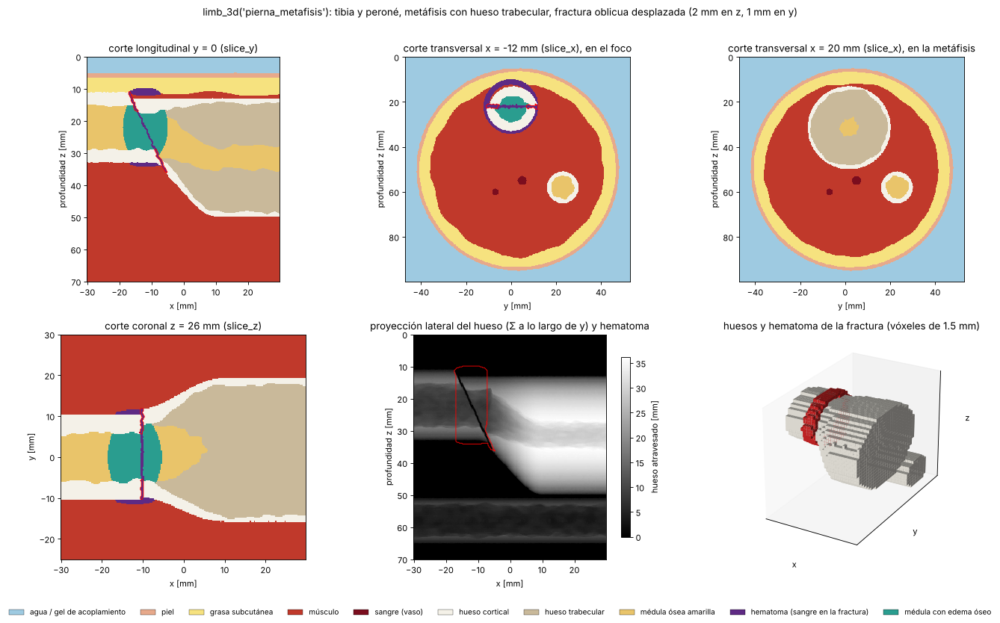

# Fantomas 3D de extremidad (`limb_3d`)

Código: `wavesim/phantoms/limb3d_full.py` (exportado desde `wavesim.phantoms`),
`RoughSurface` en `wavesim/phantoms/roughness.py` y `Phantom3D.slice_x` /
`slice_z` en `wavesim/phantoms/limb3d.py`. Tests: `tests/test_limb3d_full.py`
(32 tests, ~6 s). Banco: `benchmarks/phantom3d_performance.py` (tiempos,
memoria y coherencia con el 2D). Figura: `examples/15_fantoma_3d.py` →
`docs/img/fantoma3d.png`.



## Qué se modela

`limb_3d` es el equivalente volumétrico de los dos cortes 2D de
`phantoms/limb.py`, con las convenciones 3D comunes: arrays `(nz, ny, nx)`,
x = eje del hueso, y = lateral, z = profundidad (sonda arriba). Devuelve un
`Phantom3D` (etiquetas `int16`, máscaras `fracture`, `hematoma`, `edema`,
`meta["bone_axis"] = "x"`).

- **Sección transversal anatómica**, la de `CROSS_PRESETS`: piel y grasa
  como anillos alrededor del miembro, músculo en el compartimento interior y
  huesos excéntricos. En la pierna la tibia (R = 11 mm, cortical de 4 mm) está
  en la cara anterior, casi bajo la piel (sólo piel y grasa encima: 6 mm en el
  adulto normal), con el peroné (R = 7 mm) lateral y posterior y 5-6 cm de
  músculo por detrás; dos vasos. Presets: `pierna`, `pierna_metafisis`,
  `antebrazo` (radio y cúbito), `muslo` (fémur). El eje del hueso principal
  pasa por x = 0, y = 0 (el plano `slice_y(0)` es su corte longitudinal) y
  x = 0, y = 0 son centros de celda a cualquier `dx`.
- **Variación a lo largo de x**: ensanchamiento metafisario opcional
  (`Metaphysis`: transición suave de 20 mm, radio ×1.68, cortical de 1.5 mm y
  13 mm de hueso trabecular tapizando el endostio, los valores del preset 2D
  `tibia_metafisis`; el hueso crece hacia el centro del miembro y su cara
  subcutánea no se mueve), inclinación de los huesos en x-z y x-y
  (`bone_tilt_deg`, `bone_yaw_deg`) y giro del miembro (`rotation_deg`).
- **Fondo** de agua (por defecto), aire u otro tejido (`background`), con
  `standoff` (5 mm) encima y `margin` (5 mm) a los lados y debajo para la
  sonda, los electrodos o la fuente.
- **Rugosidad 3D**: cada interfaz (piel, grasa/piel, músculo/grasa,
  periostio y endostio de cada hueso) lleva un campo `RoughSurface` (ruido
  blanco filtrado con la autocorrelación gaussiana de `RoughProfile`, con la
  rms y la longitud de correlación de `CrossSectionSpec`) sobre (x, arco),
  periódico alrededor del miembro. La superficie de fractura, otro campo
  sobre el plano de la grieta (`Fracture3D.roughness`, longitud de
  correlación máx(gap, 0.3 mm), como en 2D). `roughness=False` da
  interfaces lisas.
- **Fracturas** (`Fracture3D`, mismos campos y significado que `Fracture`):
  transversal y oblicua (plano girado `angle_deg` alrededor de y), desplazada
  (el fragmento distal, el lado +x del plano, trasladado en z y,
  `displacement_y`, en y: escalón de verdad en 3D), fisura fina (lámina de al
  menos una celda, parcial en profundidad y en arco), conminuta
  (`extra_cracks`), incompleta (`depth_fraction`: el plano limitado en
  profundidad corta un arco del lado de la sonda), intracortical y de la
  cortical lejana (`span` con la coordenada de capas ζ del 2D), por estrés con
  reacción perióstica (lente de hueso nuevo con ribete de edema que sigue la
  curvatura del hueso) o endóstica (esclerosis), contusión ósea (edema
  intertrabecular en bolsas esféricas de Poisson y microfracturas como discos
  finos de orientación aleatoria) y espiroidea (hélice de paso
  `spiral_pitch`; `inf` = longitudinal; el equivalente de la
  `RingFracture` "longitudinal/espiroidea"). Hematoma perióstico como
  manguito en los ángulos donde la grieta sale al periostio; edema de médula
  como elipsoide (centrado o entrando desde el endostio, `edema_depth`).
  Propio del 3D: `arc_deg` / `arc_center_deg` (arco del perímetro y lado
  "cercano") y `bone_index` (la grieta sólo corta ese hueso). Una `Fracture`
  2D se acepta directamente (`Fracture3D.from_2d`).
- **Tipos de cuerpo y variabilidad**: `body=` aplica `BODY_TYPES` con
  `limb.with_body_type` sobre la sección transversal (piel y grasa escaladas,
  el compartimento muscular escalado conservando la posición relativa de
  cada hueso, cortical y diámetro óseo). `random_limb_3d_spec` es el
  `random_limb_spec` 3D: `random_body_type` (σ ≈ 10 % por factor) más ±10 %
  uniforme de piel, grasa, músculo y cortical de cada hueso, inclinación
  (σ = 2° en x-z y x-y) y giro (σ = 5°). `random_fracture_3d` reutiliza
  `random_fracture` (mismos rangos) y añade arco, desplazamiento lateral y la
  espiroidea.
- **Reproducibilidad**: toda la geometría está en coordenadas continuas
  (radios, centros, campos de rugosidad con paso propio, posiciones de
  bolsas y microfracturas en subflujos aleatorios por objeto) y se rasteriza
  por el centro de cada celda: la misma semilla da la misma anatomía a
  cualquier `dx`.
- **Utilidades**: `Phantom3D.slice_x(x)` (sección transversal, eje horizontal
  y), `slice_z(z)` (plano coronal; el "z" del `Phantom` es y), `slice_y` ya
  existía. `limb_3d_fractions(..., supersample=2)` devuelve además la fracción
  de volumen de cada tejido por celda (antialiasing de interfaces), por
  supermuestreo de la misma anatomía en una malla alineada `supersample` veces
  más fina. `equivalent_longitudinal_spec` da el `LimbSpec` 2D del corte
  y = 0 (para comparar). `limb_3d(grid=...)` rasteriza en una malla propia.

## Coherencia con el 2D (medido, `benchmarks/phantom3d_performance.py coherencia`)

Fantomas sin rugosidad, dx = 0.5 mm. "Capas y = 0": la secuencia de tejidos
de la columna x = 0 del corte `slice_y(0)` frente a `longitudinal_limb` con
`equivalent_longitudinal_spec` (los mismos grosores calculados sobre la
vertical que pasa por el eje del hueso), y la mayor diferencia en la posición
de cada interfaz. "Acuerdo x = 0": fracción de celdas del miembro con la
misma etiqueta en `slice_x(0)` y en `cross_section_limb` del mismo preset y
cuerpo, muestreado por vecino más cercano. "Dif. área": mayor diferencia
relativa de área por tejido (sin los vasos, de ~40 celdas, que difieren en
±4 celdas).

| preset | cuerpo | capas y = 0 | máx. desv. (celdas) | acuerdo x = 0 | máx. dif. área |
|---|---|---|---|---|---|
| pierna | normal | iguales | 0 | 99.94 % | 0.4 % |
| pierna | delgado | iguales | 0 | 98.05 % | 1.2 % |
| pierna | obeso | iguales | 0 | 99.26 % | 0.8 % |
| pierna | musculoso | iguales | 0 | 99.28 % | 0.8 % |
| pierna | anciano_osteoporotico | iguales | 0 | 97.48 % | 2.8 % |
| antebrazo | normal | iguales | 0 | 99.89 % | 0.7 % |
| antebrazo | delgado | iguales | 0 | 96.63 % | 1.0 % |
| antebrazo | anciano_osteoporotico | iguales | 0 | 98.29 % | 4.2 % |
| muslo | normal | iguales | 1 | 99.98 % | 0.2 % |
| muslo | anciano_osteoporotico | iguales | 1 | 98.65 % | 1.8 % |

Tolerancia pedida: ±1 celda en los grosores de la cara anterior (se cumple
en todos los casos, también en la cara posterior). Los desacuerdos del corte
transversal están en las interfaces y se deben a que las dos mallas no están
alineadas: el 2D centra la suya en el centro del miembro y el 3D en el eje
de la tibia y en z = 0, y con un radio del miembro que no es múltiplo de
`dx` (todos los tipos de cuerpo salvo el normal) los centros de celda
difieren en una fracción de celda. Con la misma semilla a 1 y 0.5 mm (con
rugosidad y una fractura oblicua desplazada), el 100 % de las celdas comunes
tienen la misma etiqueta.

Los tests comprueban además: cada tipo de fractura (los 11) da una máscara
no vacía en el sitio correcto (centroide a < 6 mm del foco en x y dentro del
hueso; las de la cortical lejana por debajo del eje, las fisuras, incompletas
e intracorticales por encima), la transversal completa corta todo el
perímetro de la tibia y no el peroné, un arco de 90° queda en el lado pedido,
el escalón del fragmento desplazado mide 2 mm ± 1 celda, la fisura es una
lámina de < 3 celdas, la hélice gira 45° cada 5 mm con paso de 40 mm, la
contusión deja el armazón trabecular (10-70 % de edema en la zona), los
grosores de cortical y grasa posterior por tipo de cuerpo siguen
`with_body_type` a ±1 celda y la grasa del obeso es ×3 la del normal
(±15 %), la metáfisis no tiene trabecular residual en la diáfisis y mide
×1.68 ± 10 %, y `ElasticSolver3D` corre 60 pasos sobre un antebrazo
fracturado sin NaN.

## Tiempo y memoria (medido)

Pierna de 60 × 100 × 100 mm (x × y × z), un proceso por caso, 1 hilo, pico de
memoria residente (incluye el intérprete y NumPy, ~70 MB):

| dx | celdas | caso | tiempo | ns/celda | pico RSS |
|---|---|---|---|---|---|
| 1 mm | 0.6 M | sana | 0.23 s | 392 | 77 MB |
| 1 mm | 0.6 M | fractura desplazada | 0.31 s | 517 | 77 MB |
| 1 mm | 0.6 M | contusión en la metáfisis | 0.48 s | 797 | 115 MB |
| 1 mm | 0.6 M | fracciones de volumen (×2) | 0.94 s | 1570 | 97 MB |
| 0.5 mm | 4.8 M | sana | 0.51 s | 107 | 94 MB |
| 0.5 mm | 4.8 M | fractura desplazada | 0.64 s | 133 | 109 MB |
| 0.5 mm | 4.8 M | contusión en la metáfisis | 1.00 s | 209 | 128 MB |
| 0.5 mm | 4.8 M | fracciones de volumen (×2) | 5.2 s | 1086 | 331 MB |
| 0.25 mm | 38.4 M | sana | 2.3 s | 59 | 157 MB |
| 0.25 mm | 38.4 M | fractura desplazada | 3.7 s | 98 | 443 MB |
| 0.25 mm | 38.4 M | contusión en la metáfisis | 4.1 s | 107 | 535 MB |

Objetivo (5 M celdas en pocos segundos y < 1 GB): 0.5-1 s y ~0.1 GB. El
fantoma ocupa 2 B/celda de etiquetas más 3 B/celda de máscaras; la
rasterización va por rodajas de x (`chunk_cells`, 2 M celdas) y evalúa la
rugosidad de las partes blandas sólo en la banda entre el músculo más interno
y la piel más externa, y la de cada hueso sólo en su caja. A 1 mm domina el
coste fijo de sintetizar los campos de rugosidad (~0.2 s, independiente de
`dx`). La fractura trabaja en una caja alrededor del foco con arrays de
coma flotante, lo que explica el pico a 0.25 mm.

## Simplificaciones respecto a la anatomía real

- Huesos de sección circular y tubulares: la tibia real es triangular (cara
  anteromedial plana, cresta anterior) y el peroné es prismático; los
  radios y centros son los de `CROSS_PRESETS`, que a su vez son
  aproximaciones de libro. Los grosores de piel, grasa y músculo son
  uniformes alrededor del miembro (salvo la rugosidad).
- Por eso el corte y = 0 no reproduce el preset longitudinal 2D `tibia`
  (grasa de 3 mm) sino la sección `pierna` (grasa de 5 mm, de la que la tibia
  ocupa 0.6 mm): `equivalent_longitudinal_spec` da el `LimbSpec`
  correspondiente. En el antebrazo y el muslo los huesos están a media
  profundidad (radio a ~20 mm de la piel; fémur a ~66 mm), como en la
  sección 2D y no como en sus presets longitudinales.
- Sin compartimentos musculares, fascias, tabiques ni periostio, sin
  infiltración grasa del músculo; vasos rectos paralelos al hueso (no se
  inclinan con él).
- Sin el modo realista 2D (porosidad cortical, red trabecular explícita,
  rugosidad fractal en ley de potencia): el hueso trabecular es un tejido
  homogéneo. `RoughSurface` sólo implementa el espectro gaussiano.
- La metáfisis es un ensanchamiento cilíndrico suave; no hay epífisis,
  cartílago, placa de crecimiento ni articulación. Las inclinaciones grandes
  pueden hacer que el hueso atraviese la grasa o la piel (no se recorta,
  como en el 2D).
- Fracturas: la grieta corta un único hueso (no hay fractura conjunta de
  tibia y peroné); el fragmento desplazado sólo se traslada (no rota) y la
  espiroidea no admite desplazamiento; la fisura más fina que `dx` se
  dibuja con una celda (`min_gap_cells = 1`, sobrestima la anchura); las
  bolsas de edema (r = 0.4 mm) y las microfracturas más finas que una celda
  sólo aparecen a dx ≲ 0.4 mm, como en 2D; las microfracturas se pintan sobre
  el edema y su celda queda también en la máscara `edema`, como en 2D.

## API pública nueva (firmas)

```python
limb_3d(preset: str | Limb3DSpec = "pierna", fracture: Fracture3D | Fracture | None = None, length=60e-3,
        dx=0.5e-3, width=None, depth=None, margin=5e-3, seed=0, body: str | BodyType | None = None,
        background: str | None = None, roughness: float | bool = True, grid: Grid3D | None = None,
        chunk_cells=2_000_000) -> Phantom3D
limb_3d_fractions(*args, supersample=2, **kwargs) -> tuple[Phantom3D, dict[str, np.ndarray]]
limb_grid(spec: Limb3DSpec, length, dx, width=None, depth=None, margin=5e-3) -> Grid3D
random_limb_3d_spec(rng, preset="pierna", body=None, jitter=0.1) -> Limb3DSpec
random_fracture_3d(rng, kind=None, x_range=8e-3, kinds=FRACTURE_KINDS_3D, bone_index=0) -> Fracture3D
limb3d_with_body_type(spec: str | Limb3DSpec, body: str | BodyType) -> Limb3DSpec
equivalent_longitudinal_spec(preset="pierna", body=None) -> LimbSpec
Phantom3D.slice_x(x=0.0) -> Phantom      # sección transversal (horizontal = y)
Phantom3D.slice_z(z) -> Phantom          # plano coronal (horizontal = x, "z" del Phantom = y)
```

`meta` de `limb_3d`: `generator`, `bone_axis = "x"`, `preset`, `spec`,
`fracture`, `seed`, `label`, `body_type`, `background`, `roughness`,
`leg_center` (y, z), `leg_radius`, `bone_centers` (y, z de cada hueso en
x = 0), `axis_depth`, `bone_top_depth` y `bone_bottom_depth` (periostio del
hueso principal en x = 0, y = 0), `skin_depth` (piel en y = 0) y
`fracture_center` (x, y, z del foco).
